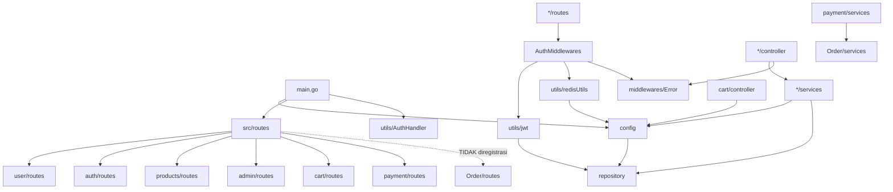
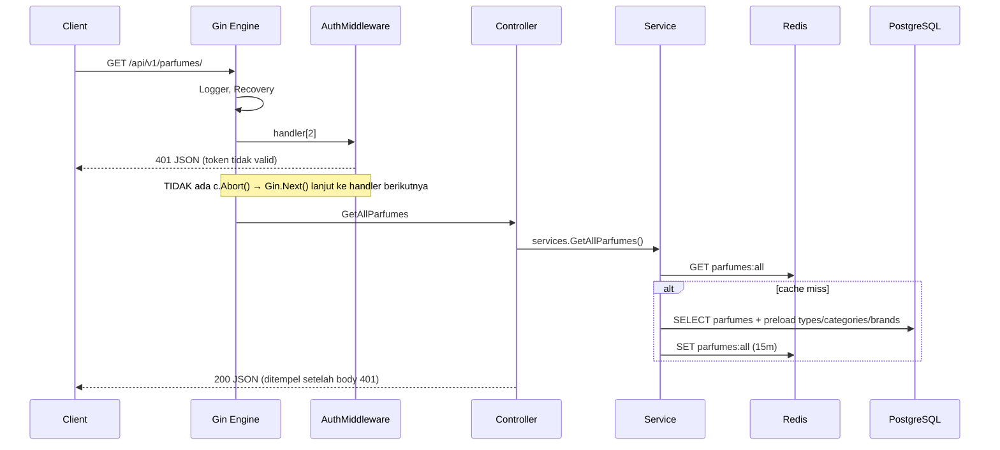
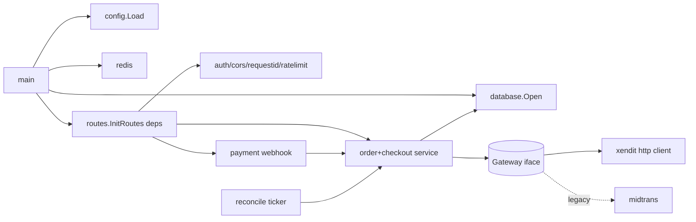
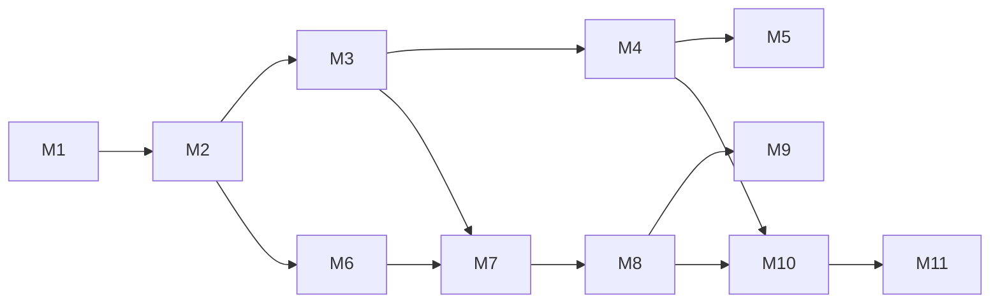

# Station-Parfume Backend: Audit Arsitektur & Roadmap Modernisasi

> **Mode:** audit READ-ONLY. Tidak ada file proyek yang diubah. `git status` bersih sebelum dan sesudah audit (branch `master`, HEAD `8f6479d`).
> **Diagnostik yang dijalankan:** `go build -mod=readonly ./...`, `go vet -mod=readonly ./...`, `gofmt -l .`, `go fmt -n` (dry-run). Selain itu ada **satu build percobaan pada salinan repo di scratchpad** (`git archive` lalu 4 import diperbaiki). Tidak ada akses DB, Redis, Midtrans, atau Xendit. Aplikasi tidak dijalankan.
> **Legenda bukti:** ✅ = terverifikasi dari kode/tool · ⚠️ = asumsi/inferensi yang perlu diverifikasi.

---

## Status Terkini (2026-11-11)

| Milestone | Status | Bukti |
|---|---|---|
| Audit (§1–§10) | ✅ Selesai | dokumen ini |
| **M1** Build Stabilization | ✅ Selesai | `8bf0e59`, `eb8368c` |
| **M2** Startup & Migration Safety | ✅ Selesai (kode) | AutoMigrate/DropColumn dihapus (`faa6654`); fail-fast JWT & Redis (`8a23337`); DSN dari env, migrasi goose, logger Warn tanpa nilai parameter (lihat [Hasil Eksekusi M2](#hasil-eksekusi-m2--database-dari-env--migrasi-goose-2026-11-11)). **Tugas Pilot:** rotasi password DB (C5) |
| **M3** Security Hotfix | ✅ Selesai | `c91ec56` (abort, `/admins`, jti, katalog publik, email) + peran `/users` dikunci (`e79373f`) + **hardening auth** (lihat [Hasil Eksekusi M3](#hasil-eksekusi-m3--hardening-auth-2026-11-11)) |
| **M5** HTTP Server Hardening | ✅ Selesai (kode) | Timeout, graceful shutdown, CORS, security header, health check, format response seragam, Swagger `/docs` (lihat [Hasil Eksekusi M5](#hasil-eksekusi-m5--hardening-server--swagger-2026-11-11)) |
| **M10** Tests & CI | ✅ Selesai | Test integrasi di repo + GitHub Actions (`.github/workflows/ci.yml`) + Dependabot mingguan |
| **M4** Go & Dependency | ✅ Selesai | Go 1.26 (image build Go 1.27.4), library diperbarui, govulncheck 0 celah terpakai, image Docker distroless non-root tanpa `.env` (lihat [Hasil Eksekusi M4](#hasil-eksekusi-m4--go--docker-2026-11-11)) |
| **M11** Deployment Readiness | ✅ Disiapkan & diuji lokal | VPS sendiri: Docker Compose (Caddy HTTPS otomatis, api, migrate, Postgres, Redis), `deploy/update.sh`, backup harian, runbook [`docs/deploy-vps.md`](deploy-vps.md) (lihat [Hasil Eksekusi M11](#hasil-eksekusi-m11--persiapan-deploy-vps-2026-11-11)). Belum di-deploy ke VPS sungguhan |
| **M6** Data Model | ✅ Diganti schema v3 | `35dc5c5` (katalog sendiri, harga per ml, stok, BIGINT, CHECK) — lihat `docs/schema/README.md` |
| **M7** Order & Checkout | ✅ Selesai | checkout transaksional, snapshot, state machine, reservasi stok, expiry |
| **M8** Xendit (test mode) | ↩️ Diganti M12 | Akun Xendit ditolak (usaha perorangan, belum PT). Kode Xendit dihapus 2026-11-12 (ada di riwayat git) |
| **M9** Midtrans (Core API lama) | ✅ Dihapus | Kode lama tidak pernah berjalan & tidak ada data produksi, jadi dihapus bersama M8 |
| **M12** Midtrans Snap | ✅ Kode selesai, uji dengan server palsu | Alur M8 dipertahankan, gateway diganti Snap; migrasi `00002`. Perlu uji manual sandbox dengan key Midtrans Pilot |

> **Catatan:** setelah M1, jalur file `src/modules/Order/...` yang disebut di dokumen ini sekarang menjadi `src/modules/order/...`. Nomor baris di file yang terkena `gofmt` bisa bergeser beberapa baris. Referensi baris di dokumen ini mengacu ke commit `8f6479d` (sebelum M1).

## Daftar Isi
1. [Executive Summary](#1-executive-summary)
2. [Current Go Version & Technology Inventory](#2-current-go-version--technology-inventory)
3. [Current Repository Architecture](#3-current-repository-architecture)
4. [Application Execution Flow](#4-application-execution-flow)
5. [Layer-by-Layer Explanation](#5-layer-by-layer-explanation-materi-belajar)
6. [Critical Issues and Technical Debt](#6-critical-issues-and-technical-debt)
7. [Database & Security Findings](#7-database--security-findings)
8. [Go 1.27 Modernization Assessment](#8-go-127-modernization-assessment)
9. [Xendit Migration Design](#9-xendit-migration-design)
10. [Proposed Target Architecture](#10-proposed-target-architecture)
11. [Prioritized Modernization Roadmap](#11-prioritized-modernization-roadmap)
12. [Recommended First Milestone](#12-recommended-first-milestone--m1-build-stabilization)
13. [Open Questions](#open-questions-untuk-pilot)

---

## Context

Pilot kembali ke proyek setelah jeda panjang. Build saat ini gagal karena *case-insensitive import collision*. Pilot ingin memahami sistem secara utuh, menutup celah keamanan, mengamankan migrasi DB, lalu memigrasikan pembayaran dari gateway lama ke **Xendit**. Dokumen ini berisi audit berbasis bukti dan roadmap bertahap. Setiap milestone baru dikerjakan setelah ada persetujuan eksplisit dari Pilot.

---

## 1. Executive Summary

**Kondisi umum:** backend Go monolit kecil (±3.700 LOC Go, 50 file .go) dengan Gin, GORM/PostgreSQL, Redis, JWT, Google OAuth, dan **Midtrans Core API** sebagai gateway saat ini. Struktur folder per fitur sudah cukup baik. Masalah utamanya ada pada kebenaran logika (correctness) dan keamanan, bukan pada arsitektur.

**Temuan paling penting:**

| # | Temuan | Severity |
|---|---|---|
| 1 | Build gagal: 4 import memakai `Payment/` padahal direktorinya `payment/`. **Sudah diverifikasi: setelah 4 baris itu diperbaiki di salinan, `go build` dan `go vet` lolos (rc=0).** | Critical (blocker) |
| 2 | **Auth bypass total.** Helper error tidak memanggil `c.Abort()`, sehingga Gin tetap menjalankan handler setelah middleware menolak request. | Critical |
| 3 | **Endpoint `/api/v1/admins` tanpa autentikasi sama sekali.** Siapa pun bisa membuat atau menghapus admin. | Critical |
| 4 | **SQL injection** lewat path param string yang diberikan langsung ke `First(&x, id)` atau `Delete(&x, id)` di GORM. Contoh: `DELETE /admins/1%20OR%201=1` akan men-soft-delete *semua* user. | Critical |
| 5 | `RoleBasedAccess` dipasang *setelah* handler, jadi handler sudah jalan sebelum role dicek. | Critical |
| 6 | Kredensial DB di-hardcode dan sudah tercatat di git history. | Critical (rotasi wajib) |
| 7 | `ConnectDatabase()` menjalankan `AutoMigrate` dan 3× `DropColumn` di **setiap startup**, dan semua error-nya diabaikan. | High |
| 8 | Nominal pembayaran diambil dari body klien, tanpa cek kepemilikan order. | Critical (saat payment aktif) |
| 9 | Alur Cart → Order → Payment **tidak pernah bisa berjalan end-to-end.** Route order tidak diregistrasi, query cart salah tabel, order item ter-insert dobel, Midtrans tidak pernah di-init, dan ada bug typed-nil error. | High |
| 10 | Tidak ada test, CI, linter, migrasi terkelola, graceful shutdown, timeout server, CORS, maupun rate limit. 44 dari 50 file belum di-`gofmt`. | Medium |

**Rekomendasi:** **Option A (modernisasi inkremental)**. Struktur `src/modules/<fitur>` dipertahankan, lalu diperbaiki per milestone kecil. Untuk Xendit: **Payment Sessions (`session_type=PAY`, `mode=PAYMENT_LINK`) lewat HTTP langsung (`net/http`)**, karena SDK resmi `xendit-go/v7` (v7.0.0) belum mendukung `/sessions`.

**Milestone pertama:** M1 *Build Stabilization* (perbaikan 4 import, normalisasi casing folder `Order` → `order`, gofmt). Perilaku aplikasi tidak berubah dan aplikasi tetap tidak dijalankan sampai M2 (keamanan startup DB) selesai.

---

## 2. Current Go Version & Technology Inventory

### 2.1 Versi Go

| Item | Nilai | Bukti |
|---|---|---|
| Module name | `backend` | `go.mod:1` ✅ |
| `go` directive | `go 1.24.4` | `go.mod:3` ✅ |
| `toolchain` directive | tidak ada | `go.mod` ✅ |
| Toolchain lokal | `go1.27.3` (snap) | `/snap/go/current/VERSION` ✅ (stdout `go version` tidak tertangkap di sandbox) |
| Docker build image | `golang:1.24.4` | `dockerfile:2` ✅ |

**Status dukungan:** Go mendukung dua rilis mayor terakhir. Per November 2026 itu adalah **1.27 dan 1.26**, jadi **Go 1.24 sudah EOL** ⚠️ (berdasarkan kebijakan rilis Go, bukan hasil cek tool).

### 2.2 Perbedaan tiga jenis "upgrade" (penting dipahami)

| Aksi | Apa yang berubah | Efek |
|---|---|---|
| **Upgrade compiler/toolchain** (mis. pakai Go 1.27.3) | Program `go` yang mengompilasi | Kode tetap dikompilasi dengan **semantik bahasa sesuai `go` directive** (1.24). Yang didapat: perbaikan bug/keamanan stdlib dan performa compiler. Repo ini sudah terbukti bisa di-build dengan 1.27.3 setelah fix import. |
| **Mengubah `go` directive di `go.mod`** (mis. `go 1.26`) | Versi minimum bahasa dan perilaku stdlib (GODEBUG default) | Mengaktifkan fitur bahasa baru dan default perilaku baru. Siapa pun yang build butuh toolchain ≥ versi itu. |
| **Modernisasi dependency** (`go get -u`, `go mod tidy`) | Versi library di `go.mod`/`go.sum` | Bisa membawa breaking change API. Harus dilakukan terpisah dan diuji. |

### 2.3 Library yang benar-benar dipakai (dari import di source) ✅

| Kategori | Library | Versi (go.mod) | Catatan |
|---|---|---|---|
| HTTP framework | `github.com/gin-gonic/gin` | v1.10.1 | satu-satunya `require` langsung |
| ORM | `gorm.io/gorm` | v1.30.2 | ditandai `// indirect` padahal dipakai langsung |
| Driver PG | `gorm.io/driver/postgres` → `jackc/pgx/v5` | v1.6.0 → v5.6.0 | |
| JSON column | `gorm.io/datatypes` | v1.2.6 | menarik `gorm.io/driver/mysql` dan `go-sql-driver/mysql` secara transitif ⚠️ |
| Cache/blacklist | `github.com/redis/go-redis/v9` | v9.11.0 | |
| JWT | `github.com/golang-jwt/jwt/v5` | v5.3.0 | HS256 |
| Password | `golang.org/x/crypto/bcrypt` | x/crypto v0.40.0 | DefaultCost (10) |
| OAuth | `golang.org/x/oauth2` (+`/google`) | v0.30.0 | |
| Validasi | `github.com/go-playground/validator/v10` | v10.26.0 | instance global per package |
| Env | `github.com/joho/godotenv` | v1.5.1 | **hanya dipanggil di `InitMidtrans()` yang tidak pernah dipanggil** |
| Payment | `github.com/midtrans/midtrans-go` | v1.3.8 | Core API (`coreapi`) |
| Seeder | `github.com/xuri/excelize/v2` | v2.9.1 | path Windows di-hardcode |
| UUID | `github.com/google/uuid` | v1.6.0 | jti refresh token |
| (tidak dipakai) | `google.golang.org/api/idtoken` | v0.241.0 | import dikomentari (`auth.services.go:20`) |

**Kesehatan `go.mod`:** semua dependency yang dipakai langsung ditandai `// indirect` (`go.mod:7-82`), artinya `go.mod` tidak rapi. `go mod tidy` belum dijalankan (sesuai aturan). Itu dijadwalkan di M4 dengan review diff.

**Outdated/vulnerability:** `go list -m -u` dan `govulncheck` **tidak bisa dijalankan** di sandbox (stdout snap-go hilang, govulncheck belum terpasang, build masih rusak). Kemungkinan besar ⚠️: stdlib Go 1.24.4 punya CVE yang sudah dipatch di rilis berikutnya, dan `x/net` v0.41 serta `x/crypto` v0.40 perlu dicek. **Ini aksi wajib pertama di M4.** Tidak ada alasan mengganti Gin, GORM, go-redis, atau jwt/v5. Semuanya masih aktif dan cocok untuk aplikasi seukuran ini.

### 2.4 Tooling, build, deployment ✅

| Item | Status |
|---|---|
| Test (`*_test.go`) | **0 file** |
| CI/CD (`.github/`, dll.) | tidak ada |
| Linter config / Makefile | tidak ada |
| `.env` / `.env.example` | tidak ada di repo (`.env` di-gitignore, `.gitignore:31-33`) |
| `.dockerignore` | tidak ada. `COPY . .` (`dockerfile:13`) akan ikut menyalin `.env` lokal ke image jika file itu ada |
| Dockerfile | single-stage, jalan sebagai root, image ±1 GB, DSN `host=localhost` tidak akan jalan di container |
| Format | 44/50 file tidak lolos `gofmt -l` |

---

## 3. Current Repository Architecture

### 3.1 Pola arsitektur

Ini **monolit feature-based dengan layering ala MVC per modul** (route → controller → service → GORM). Model GORM tersentralisasi di satu package `repository`. Package itu sebenarnya *bukan* repository pattern; isinya hanya definisi model/schema. Lapisan "repository" (akses data) tidak ada, karena service memanggil `config.DB` (global) langsung.

```
main.go
src/
├── config/            DB (global var DB), Redis (global), Midtrans (global), seeders/
├── middlewares/
│   ├── AuthMiddlewares/   JWT access/refresh + RoleBasedAccess
│   └── Error/             helper JSON error (package httperror)
├── modules/
│   ├── Order/   (huruf besar!) controller/ models/ routes/ services/
│   ├── admin/   controller/ models/ routes/ services/
│   ├── auth/    controller/ models/ routes/ services/
│   ├── cart/    controller/ models/ routes/ services/
│   ├── payment/ controller/ models/ routes/ services/
│   ├── products/ (parfume, brand, bottle)
│   └── user/
├── repository/repository.go   SEMUA model GORM (User, Parfume, Brand, Cart, Order, Payment, ...)
├── routes/routes.go           agregator route /api/v1
└── utils/  AuthHandler/ (Google OAuth config global), jwt/, redisUtils/
```

Per modul ada 4 package (`controller`, `models`=DTO, `routes`, `services`). Untuk 7 modul itu menjadi 28 package kecil. Package di dalam modul yang berbeda punya **nama yang sama** (`controller`, `services`, `models`), jadi import alias sering dibutuhkan.

### 3.2 Graf dependensi package (terverifikasi dari import)



Tidak ada import cycle (compiler akan menolaknya). Ada **coupling yang tidak perlu:** `cart/controller` mengakses `config.DB` langsung (`cart.controller.go:38`), dan `payment/services` memanggil `Order/services` (`payment.services.go:11,173`). Pemanggilan yang kedua wajar, tapi saat ini tanpa transaksi.

### 3.3 Tanggung jawab tiap direktori

| Direktori | Tanggung jawab nyata | Masalah |
|---|---|---|
| `config` | Membuka koneksi DB/Redis/Midtrans dan menyimpannya di **variabel global**; menjalankan migrasi dan DropColumn | Mencampur konfigurasi, infrastruktur, dan migrasi. Tidak ada struct konfigurasi. Secret di-hardcode. |
| `middlewares` | Auth JWT, RBAC, helper respons error | Helper error tidak abort (lihat C1) |
| `modules` | Fitur bisnis | Logika bisnis bercampur dengan GORM. Ada DB access di controller (cart). Casing `Order` tidak konsisten. |
| `repository` | Definisi semua model GORM | Namanya menyesatkan karena isinya bukan repository |
| `routes` | Agregasi route `/api/v1` | Order tidak didaftarkan |
| `utils` | JWT, Redis blacklist, Google OAuth config global | `AuthHandler` sebenarnya config, bukan util |

### 3.4 Peta modul & representative request

| Modul | Route terdaftar | Contoh trace | Status fungsional |
|---|---|---|---|
| auth | `/auth/register, /login, /login/admin, /google, /google/callback, /logout, /refresh` | `POST /auth/login` → `controller.LoginManual` (`auth.controller.go:28`) → `services.LoginManual` (`auth.services.go:64`) → `config.DB.Where("email = ?")` → bcrypt → `jwt.GenerateAccessToken` → JSON 200 | Login berfungsi. Logout rusak. Token akses yang dihasilkan selalu ditolak middleware karena tanpa jti (lihat H1). |
| user | `/users` CRUD (admin) | `GET /users/:id` → AuthMiddleware → **handler dulu** → RoleBasedAccess | Bypass auth dan role. Rawan SQLi. |
| admin | `/admins` CRUD | `POST /admins/` → `CreateAdminHandler` → `services.CreateAdmin` → insert role=admin | **Tanpa auth** |
| products | `/parfumes`, `/brands`, `/bottles` | `GET /parfumes/` → Auth → `GetAllParfumes` → Redis GET `parfumes:all` → miss → `Preload(Type,Category,Brand).Find` → SET cache 15 menit | GET berfungsi (karena bypass). **Semua Create selalu gagal** (lihat H6). |
| cart | `/cart` | `POST /cart/:id/items` → `AddItemToCartHandler` memakai `inputItem` kosong (`cart.controller.go:68,80`) | **Rusak** semua kecuali Clear |
| Order | (tidak terdaftar) | `services.CreateOrder` query `cart_items.user_id` yang tidak ada (`order.services.go:22`) | **Mati / rusak** |
| payment | `/payments` | `POST /payments/` → `CreatePayment` → Midtrans Charge (klien tidak di-init) | **Rusak** dan tidak aman |

---

## 4. Application Execution Flow

| Langkah | Implementasi aktual | Bukti |
|---|---|---|
| 1. Entry | `main()` | `main.go:16` |
| 2. Config | **Tidak ada pemuatan `.env`.** `godotenv.Load()` hanya ada di `InitMidtrans()` yang tidak pernah dipanggil. Semua `os.Getenv` hanya membaca environment shell. | `midtrans.go:14`, grep ✅ |
| 3. Redis | `config.InitRedis()`, **error return diabaikan** | `main.go:17`, `redis.go:12-25` |
| 4. Database | `ConnectDatabase()`: DSN hardcoded → `gorm.Open` → `AutoMigrate(10 model)` (error diabaikan) → 3× `DropColumn` (error diabaikan) → `DB = db` | `database.go:13-41` |
| 5. Middleware global | `gin.Default()` = Logger + Recovery. Tidak ada CORS, request-ID, maupun limit body. | `main.go:23` |
| 6. Route | `routes.InitRoutes(router)`. `os.Getenv("JWT_SECRET")` **dievaluasi saat registrasi** dan dibekukan dalam closure middleware. | `routes.go:14`, `user.routes.go:13` |
| 7. OAuth | `InitGoogleOauthConfig()` dipanggil **setelah** route didaftarkan (masih aman karena dibaca saat request) | `main.go:25` |
| 8. Serve | `router.Run(":"+port)`, artinya `http.ListenAndServe` tanpa timeout | `main.go:31` |
| 9. Shutdown | **Tidak ada.** Tidak ada signal handling, dan DB/Redis tidak ditutup. | ✅ |



---

## 5. Layer-by-Layer Explanation (materi belajar)

### 5.1 Bagaimana aplikasi start
`main.go` adalah package `main`. Go menjalankan `init()` semua package yang diimport (di repo ini tidak ada `init()`), lalu `main()`. Urutan di sini: Redis → DB (sekaligus migrasi) → Gin → route → OAuth → listen. Karena state disimpan di **variabel global package** (`config.DB`, `config.RedisClient`, `config.MidtransClient`, `authhandler.GoogleOauthConfig`), semua package lain bisa memakainya tanpa *dependency injection*. Cara ini sederhana, tetapi sulit dites dan urutan inisialisasinya rapuh. Contohnya, `MidtransClient` tidak pernah di-init dan compiler tidak memberi peringatan apa pun.

### 5.2 Package & import di Go
- `go.mod` mendeklarasikan **module path** `backend`. Import path = module path + path direktori: `backend/src/modules/payment/services`.
- **Nama package** (`package services`) terpisah dari nama direktori. Pemanggil memakai nama package, kecuali kalau diberi alias (`httperror "backend/src/middlewares/Error"`).
- **Import path case-sensitive.** Di Linux, `backend/src/modules/Payment/...` tidak ada karena direktorinya `payment`, sehingga muncul "package ... is not in std". Go juga **melarang dua import path yang hanya berbeda huruf besar/kecil dalam satu build**, supaya proyek tetap portabel ke filesystem case-insensitive (macOS/Windows). Dari situlah muncul error *case-insensitive import collision*. Kemungkinan besar folder ini dulu bernama `Payment` di Windows (lihat path `C:\Webdev\...` di `seed_parfume.go:14`), lalu di-rename tanpa memperbarui import. ⚠️
- Konvensi Go: nama direktori/package **huruf kecil, satu kata, tanpa underscore/dash**. Di repo ini yang melanggar: `Order`, `AuthMiddlewares`, `Error`, `AuthHandler`, `redisUtils`.

### 5.3 Mengapa ada batas controller / service / repository / model
- **Controller (handler):** urusan HTTP, yaitu parse/validasi input, ambil identitas user dari context, mapping error ke status code.
- **Service:** aturan bisnis, misalnya "harga dihitung dari DB, bukan dari klien" atau "order hanya bisa dibatalkan saat pending". Layer ini tidak tahu apa-apa soal HTTP.
- **Repository/query:** cara membaca dan menulis data. Di aplikasi kecil, **service boleh langsung memakai `*gorm.DB`**. Interface repository terpisah baru berguna kalau dibutuhkan untuk test atau ada lebih dari satu storage.
- **Model:** GORM model = bentuk tabel. DTO = bentuk JSON API. Pemisahan ini penting supaya kolom seperti `Password` tidak ikut bocor ke respons.
- Contoh pelanggaran di repo: `GetCartByUserIDHandler` melakukan query DB di controller (`cart.controller.go:38`), dan menariknya query itu memakai DTO sebagai model sehingga tabelnya menjadi `cart_request_dtos`, yang tidak ada.

### 5.4 GORM ↔ PostgreSQL
- `gorm.Open(postgres.Open(dsn))` membuat `*gorm.DB` di atas pool koneksi `database/sql` (pgx). `*gorm.DB` aman dipakai bersamaan oleh banyak goroutine.
- `AutoMigrate` membuat tabel/kolom/index/FK yang belum ada. Ia **tidak** menghapus kolom dan tidak punya versi maupun rollback. GORM juga otomatis ikut memigrasi tabel dependensi (`order_statuses`, `categories`, `types`). ⚠️
- Nama tabel diturunkan dari nama struct: `Parfume` → `parfumes`, `Categories` → `categories`, `CartRequestDTO` → `cart_request_dtos`.
- `Preload("Items")` menjalankan query terpisah `WHERE cart_id IN (...)`, jadi bukan N+1. Tetapi **loop `First()` per item adalah N+1** (`cart.service.go:27-37`, `order.services.go:29-60`).
- **Bahaya inline condition berupa string:** di `gorm/statement.go:292-299` ✅, kalau argumen string *bukan angka* dan tanpa args, GORM memperlakukannya sebagai **potongan SQL mentah**. Karena itu `First(&user, c.Param("id"))` bisa diinjeksi.
- `Find()` **tidak pernah** mengembalikan `ErrRecordNotFound` (hanya `First/Take/Last` yang mengembalikannya). Kesalahpahaman ini yang membuat semua endpoint Create produk rusak.

### 5.5 Autentikasi & middleware
- Login lokal: email → bcrypt compare → menerbitkan **access token** (HS256, 15 menit, `token_type=access`, **tanpa jti**) dan **refresh token** (24 jam, `token_type=refresh`, jti UUID, secret berbeda) (`jwt.go:20-50`).
- `AuthMiddleware` (`AuthMiddleware.go:12-66`): cek header `Bearer`, parse dengan key `JWT_SECRET`, wajibkan `jti` dan `token_type=access`, cek blacklist Redis `blacklist:<jti>`, lalu `c.Set("userID"/"email"/"role")`.
- **Cara kerja chain di Gin:** `Context.Next()` adalah loop `for c.index < len(handlers) { handlers[c.index](c); c.index++ }` (`gin@v1.10.1/context.go:182-188`) ✅. Middleware yang hanya `return` **tidak menghentikan chain**. Hanya `c.Abort()` (yang memindahkan index ke akhir) yang menghentikannya. Semua helper di `errorHandler.go` memakai `c.JSON`, bukan `c.AbortWithStatusJSON`. Jadi setiap penolakan auth hanya menulis 401, lalu handler tetap jalan.
- Urutan handler adalah urutan argumen: `userGroup.GET("/:id", controller.GetUserById, RoleBasedAccess("admin"))` menjalankan controller **lebih dulu**.
- Refresh: `RefreshTokenMiddleware` lalu `services.RefreshToken` me-rotate token dan mem-blacklist jti lama. Konsep ini sudah benar.
- Google OAuth: redirect dengan `state` statis → callback tukar code → userinfo v2 → buat/cari user → redirect ke `http://localhost:3000/oauth-success?access_token=...&refresh_token=...`.

### 5.6 Perjalanan HTTP request
Lihat diagram sequence di §4. Ringkasnya: `net/http` → `gin.Engine.ServeHTTP` → router tree mencocokkan `/api/v1/...` → chain `[Logger, Recovery, group middlewares..., route handlers...]` → controller menulis respons melalui `c.JSON` → Logger mencatat status.

### 5.7 Interaksi order & payment (sebagaimana ditulis)
```mermaid
sequenceDiagram
  participant FE as Frontend
  participant API
  participant DB
  participant MT as Midtrans
  FE->>API: POST /cart (items) [rusak: cek userID sebelum bind]
  FE->>API: POST /orders [route TIDAK terdaftar]
  Note over API: CreateOrder query cart_items.user_id (kolom tidak ada)
  FE->>API: POST /payments {user_id, order_id, amount, order_ref, payment_detail}
  API->>MT: ChargeTransaction(amount dari klien) [klien tanpa server key]
  API->>DB: INSERT payments
  MT->>API: POST /payments/notification [butuh JWT; Midtrans tidak punya]
  API->>MT: CheckTransaction(order_id)
  API->>DB: WHERE order_id = '<string ref>' (kolom uint → error)
  API->>DB: UpdateOrderStatus("paid") [status "paid" tidak pernah di-seed]
```
**Kesimpulan:** ✅ alur pembayaran **tidak pernah bisa berhasil** dalam kondisi kode saat ini. ⚠️ Kemungkinan besar belum ada data pembayaran riil. Ini perlu dikonfirmasi oleh Pilot (lihat §Open Questions).

---

## 6. Critical Issues and Technical Debt

### 6.1 Build
| ID | Temuan | Lokasi | Severity |
|---|---|---|---|
| B1 | Import `Payment/...` vs direktori `payment/` | `payment.controller.go:5-6`, `payment.routes.go:5`, `payment.services.go:5` | Critical |
| B2 | Folder `Order` huruf besar (konsisten, jadi build lolos, tetapi melanggar konvensi dan menjadi bom waktu yang sama) | `src/modules/Order/` | Medium |
| B3 | **Terverifikasi:** setelah B1 diperbaiki di salinan scratchpad, `go build` dan `go vet` lolos. Tidak ada error compile lain. | — | info |
| B4 | `go.mod` tidak rapi (semua `// indirect`), ada modul tidak terpakai (`idtoken`) | `go.mod` | Low |
| B5 | 44/50 file tidak ter-`gofmt` | seluruh repo | Low |

### 6.2 Bug logika (runtime)
| ID | Temuan | Lokasi | Severity |
|---|---|---|---|
| H1 | Access token tanpa `jti`, padahal middleware mewajibkannya, jadi **setiap token akses ditolak** (tertutupi oleh bypass C1) | `jwt.go:26-29` vs `AuthMiddleware.go:43-46` | High |
| H2 | Logout memakai `AuthMiddleware` (access) tetapi service mem-parse sebagai refresh token dengan `JWT_REFRESH_SECRET`, sehingga logout selalu gagal | `auth.routes.go:20`, `auth.services.go:225` | High |
| H3 | **Typed-nil error:** `err` bertipe `error` menampung `*midtrans.Error(nil)`, sehingga `err != nil` selalu true dan charge yang sukses diperlakukan sebagai gagal | `payment.services.go:20,40-43` (+ `midtrans-go/error.go:14`, `coreapi/client.go:70`) ✅ | High |
| H4 | `MidtransClient` tidak pernah di-init (`InitMidtrans` tidak dipanggil) | `midtrans.go:13`, `main.go` | High |
| H5 | Validator tag `"required, gt=0"` (ada spasi) **membuat validator panic** di setiap validasi Parfume | `parfume.models.go:11` | High |
| H6 | `Find()` + cek `err == nil` → Create Bottle/Parfume selalu "already exists". Create Brand selalu error. | `bottle.services.go:24`, `parfume.services.go:25`, `brand.services.go:21-25` | High |
| H7 | `CreateParfume` tidak mengisi `BrandID` | `parfume.services.go:42-51` | Medium |
| H8 | Cart: cek `userID != input.UserID` *sebelum* bind (selalu 403). Handler membaca param `userID` padahal route `:id`, dan query DTO-nya salah tabel. `AddItem` memakai struct kosong. | `cart.controller.go:13-18,36-38,68-80` | High |
| H9 | Order: route tidak diregistrasi; query `cart_items.user_id` tidak ada; order items di-append 2× dan di-insert ulang (duplikat PK); `CancelOrder` membaca param `user_id` yang tidak ada; magic status ID 1/4; tabel status tidak di-seed | `routes.go:14-25`, `order.services.go:22,29-44,51-70,89-94,197-201`, `order.controller.go:79` | High |
| H10 | Notifikasi payment: lookup `order_id = '<string ref>'` pada kolom `uint` | `payment.services.go:139` | High |
| H11 | `PaymentDetail["bank"].(string)` panic kalau key tidak ada. `BankTransfer` selalu diisi apa pun `payment_type`-nya. | `payment.services.go:34-37` | Medium |
| H12 | `GetPayment(paymentID, orderID)` dikirim ke parameter `(userID, orderID)` | `payment.controller.go:72`, `payment.services.go:89` | Medium |
| H13 | `UpdateUser` menyimpan respons berisi ID 0 dan `Provider` kosong | `user.services.go:119-136` | Low |
| H14 | Brand controller: tidak ada `return` setelah bind error | `brand.controller.go:15-16` | Low |
| H15 | Kegagalan `Redis SET` membuat request gagal (cache diperlakukan sebagai dependency keras), padahal error `InitRedis` diabaikan | `parfume.services.go:171,214`, `brand.services.go:83`, `bottle.services.go:147`, `main.go:17` | Medium |
| H16 | Logout mengembalikan `c.JSON(204, body)`. Status 204 tidak boleh punya body. | `auth.controller.go:81` | Low |

### 6.3 Technical debt arsitektur
- **Global mutable state** (`config.DB`, `RedisClient`, `MidtransClient`, `GoogleOauthConfig`, `validate` ×5). Dampaknya: tidak bisa di-unit test tanpa DB nyata. Severity Medium.
- **Tidak ada `context.Context` dari request.** Semua memakai `context.Background()`, sehingga query tidak ikut dibatalkan saat klien disconnect. Severity Medium.
- **Tidak ada transaksi DB** di seluruh repo (CreateCart, CreateOrder, HandleNotification). Severity High untuk order/payment.
- Error di-wrap dengan `%v` (rantai error putus), lalu `err.Error()` dikirim mentah ke klien. Severity Medium.
- Logging memakai `fmt.Println` + emoji, dan GORM logger level `Info` mencatat **semua SQL beserta parameternya** (email, hash) (`database.go:17`). Severity Medium.
- Fragmentasi: 4 package per modul untuk 4–10 file. Cukup diterima, tetapi menambah alias import. Severity Low.
- Kode mati: `DeleteBottle`, `GetBrandByID` tanpa route; seluruh modul Order; `models.BottleType/BottleSize/ParfumeType/Category`; `PaymentStatusDTO`.

---

## 7. Database & Security Findings

### 7.1 Database

| ID | Temuan | Lokasi | Severity |
|---|---|---|---|
| D1 | **DDL destruktif saat startup:** `DropColumn(Brand,"parfume_id")`, `DropColumn(Parfume,"Type")`, `DropColumn(Parfume,"Category")` jalan di **setiap boot** di environment mana pun, dan error-nya diabaikan | `database.go:36-38` | High |
| D2 | `AutoMigrate` di startup, return error diabaikan. Tidak ada versi migrasi, tidak ada rollback, dan race kalau >1 instance start bersamaan | `database.go:24-35` | High |
| D3 | Uang disimpan sebagai `float64` (harga, total, amount). Ada pemotongan `int64(input.Amount)` ke Midtrans. | `repository.go:58,84,100,121,138,151`, `payment.services.go:32` | High (untuk payment) |
| D4 | Tidak ada transaksi pada operasi multi-tabel | cart/order/payment services | High |
| D5 | Tidak ada index pada FK lookup: `cart_items.cart_id`, `order_items.order_id`, `orders.user_id`, `payments.order_id`, `carts.user_id`. Postgres tidak otomatis membuat index untuk FK. | `repository.go` | Medium |
| D6 | `payments` tanpa FK ke `orders`/`users` (tidak ada field asosiasi). `TransactionID` `uniqueIndex` NOT NULL default `''` akan bentrok untuk baris kedua yang kosong. | `repository.go:76-93` | Medium |
| D7 | Tidak ada unique `carts.user_id` (user bisa punya banyak cart), tidak ada unique `(cart_id, parfume_id, bottle_id)`, tidak ada CHECK `quantity > 0` | `repository.go:95-114` | Medium |
| D8 | Status order berupa tabel lookup `order_statuses` tanpa seed. Kode memakai ID magic 1/4 dan nama "paid". | `repository.go:9-17`, `order.services.go:75-78,197-201` | High |
| D9 | N+1 di loop item; tidak ada pagination di list (`GetAllParfumes`, `GetAllUsers`, `GetAllBrands` meng-preload *semua* parfum) | lihat §5.4 | Medium |
| D10 | `users.email` uniqueIndex + soft delete → email yang sudah dihapus tidak bisa daftar ulang | `repository.go:33,41` | Low |
| D11 | Seeder memakai path Windows hardcoded dan error `FirstOrCreate` diabaikan | `seed_parfume.go:14,55-67` | Low |

**Penilaian risiko D1/D2:**
- `DropColumn` dengan nama field Go (`"Type"`) yang ternyata adalah *field relasi* tidak punya DBName. Hasilnya bisa query error (diabaikan) atau, kalau di masa depan ada kolom dengan nama itu, **data hilang permanen** di setiap restart. ⚠️ Perilaku persisnya per versi GORM perlu dicek, tapi risikonya tetap tidak bisa diterima.
- Kalau `DB` mengarah ke produksi (DSN hardcoded `localhost`), siapa pun yang menjalankan binary langsung memodifikasi schema.
- **Strategi aman (direkomendasikan):**
  1. Hapus seluruh migrasi dari jalur startup. Aplikasi cukup **memverifikasi** koneksi (Ping).
  2. Pakai alat migrasi versioned berbasis SQL: **`pressly/goose`** (SQL murni, up/down, bisa di-embed, CLI sederhana). Alternatifnya `golang-migrate`.
  3. Buat **baseline migration** dari `pg_dump --schema-only` DB dev saat ini. Ini dilakukan oleh Pilot, karena akses DB tidak boleh oleh auditor.
  4. Setiap perubahan schema dibuat sebagai file `NNN_desc.sql` dengan `-- +goose Down`. Perubahan destruktif dipecah dua tahap (expand → deploy → contract).
  5. Jalankan migrasi sebagai **langkah deploy terpisah** (`goose up`), bukan saat app boot. `AutoMigrate` boleh dipakai hanya di test.

### 7.2 Security

| ID | Temuan | Lokasi | Severity |
|---|---|---|---|
| C1 | **Middleware tidak abort → auth bypass di semua route terproteksi.** `httperror.*` memakai `c.JSON`. `AuthMiddleware` dan `RefreshTokenMiddleware` hanya `return`. | `errorHandler.go:9-110`, `AuthMiddleware.go:16-58,72-111`, `gin/context.go:182-188` ✅ | **Critical** |
| C2 | **`/admins` tanpa middleware apa pun:** create, read, update, dan delete admin terbuka untuk publik | `admin.routes.go:9-17` | **Critical** |
| C3 | **SQL injection** lewat inline condition string: `First(&x, id)` / `Delete(&x, id)` dengan `id := c.Param("id")` | `user.services.go:87,109,143`, `admin.services.go:48,59,94,97`, `parfume.services.go:189,223`, `gorm/statement.go:292-299` ✅ | **Critical** |
| C4 | `RoleBasedAccess` diletakkan setelah handler | `user.routes.go:16-20`, `parfume.routes.go:17,33`, `order.route.go:17` | **Critical** |
| C5 | Password DB plaintext di-hardcode di DSN dan **sudah masuk git history**. Nilainya tidak ditampilkan di laporan ini. | `database.go:14` | **Critical** → rotasi + pindah ke env |
| C6 | Nominal, `order_ref`, `user_id` pembayaran diambil dari klien; tidak ada validasi terhadap order; cache Redis mengembalikan payment lama | `payment.models.go:4-13`, `payment.services.go:16-32,19-26` | **Critical** |
| C7 | Endpoint notifikasi gateway berada di balik JWT (gateway tidak bisa memanggilnya, kecuali lewat bypass C1); tanpa verifikasi signature, idempotensi, maupun transaksi. Sisi baiknya, ada re-fetch status via `CheckTransaction`. | `payment.routes.go:12-16`, `payment.services.go:125-180` | High |
| C8 | IDOR: cart GET/POST/DELETE by id, orders by `user_id`, GET payment, dan `CreateOrder.UserID` dari body. Tidak ada satu pun cek kepemilikan berbasis token. | `cart.controller.go:35-105`, `order.controller.go:54-68`, `order.models.go:6`, `payment.controller.go:51-82` | High |
| C9 | `UpdateUser` menyimpan **password plaintext**. `Updates(request)` memakai DTO yang berisi password mentah, sementara hash-nya tidak pernah disimpan. Endpoint ini juga bisa mengubah `role`. | `user.services.go:112-116` | High |
| C10 | Password plaintext dicetak ke stdout | `user.services.go:24` | High |
| C11 | Seeder admin menyimpan password plaintext (dan akibatnya admin tidak bisa login karena bcrypt gagal) | `seed_admin.go:14` | High |
| C12 | OAuth `state` statis dan tidak divalidasi (CSRF login). Token dikirim di query string URL (bocor via history/log/Referer). Redirect `localhost:3000` di-hardcode. Error decode diabaikan. `verified_email` tidak dicek. | `auth.services.go:142,177,212` | High |
| C13 | Userinfo v2 Google mengembalikan `id`, bukan `sub`, sehingga `Sub` selalu nil ⚠️ (berdasarkan dokumentasi Google, belum diuji) | `login.model.go:15`, `auth.services.go:169` | Low |
| C14 | Enumerasi user & kebocoran error: "user not found: record not found" vs "invalid password: crypto/bcrypt…", dikirim sebagai 500. Banyak `err.Error()` dikirim ke klien. | `auth.services.go:68,75`, `auth.controller.go:36,53` | Medium |
| C15 | Registrasi tidak mewajibkan password (`omitempty`, tanpa `validate`), jadi akun lokal bisa dibuat dengan password kosong | `register.model.go:6` | Medium |
| C16 | Tidak ada CORS, rate limiting (login/register/refresh), batas ukuran body, atau security headers | `main.go` | Medium |
| C17 | Tidak ada timeout HTTP server (slowloris) | `main.go:31` | Medium |
| C18 | Kalau `.env` tidak dimuat, `JWT_SECRET` bisa kosong dan token ditandatangani dengan key kosong ⚠️ (perlu dicek apakah jwt v5.3.0 menolak key kosong) | `jwt.go:33`, `user.routes.go:13` | High (kondisional) |
| C19 | Model `User.Password` ber-tag `json:"password"`, dan `AdminResponse` punya field `Password`. Ini berisiko bocor kalau model diserialisasi. | `repository.go:34`, `admin.models.go:11` | Medium |
| C20 | GORM logger level Info mencatat semua SQL beserta nilai parameternya | `database.go:17` | Medium |
| C21 | Katalog produk (GET) mewajibkan login. Sementara itu POST parfum/brand/bottle tidak dibatasi admin. | `parfume.routes.go:12-33` | Medium |
| — | **Positif:** bcrypt dipakai untuk password (register/admin), query `Where("x = ?", v)` sudah terparameterisasi, refresh token di-rotate dengan blacklist jti, dan cek `SigningMethodHMAC` (mencegah `alg` confusion). | | |

> **Status 2026-11-11:** C12–C16 (kecuali CORS/batas body/security header), C18 dan H2/H16 sudah diperbaiki, dan modul `/admins` (C2, C19 sisi admin) dihapus. Lihat [Hasil Eksekusi M3](#hasil-eksekusi-m3--hardening-auth-2026-11-11).

---

## 8. Go 1.27 Modernization Assessment

**Target versi:** set `go 1.26.0` di `go.mod` (versi minimum yang masih didukung) dan **build dengan toolchain 1.27.3** di lokal, Docker, dan CI. Alasannya, belum ada fitur 1.27 yang dibutuhkan, dan dengan 1.26 kode tetap bisa dibangun oleh kedua rilis yang didukung. Kalau Pilot ingin satu versi tunggal yang sederhana, `go 1.27.0` juga valid. Status: **REQUIRED** (1.24 sudah EOL).

| Area | Sekarang | Masalah | Usulan | Kenapa lebih baik | Risiko | Status |
|---|---|---|---|---|---|---|
| Versi Go / Docker | 1.24.4 | EOL, CVE stdlib | `go 1.26.0`, Docker `golang:1.27.3` multi-stage → distroless/alpine non-root | dapat patch keamanan, image kecil | Rendah | REQUIRED |
| Dependency | untidy | `// indirect` salah, modul mati | `go mod tidy` + `go get -u=patch`, review diff | `go.mod` jujur, kecil | Rendah-sedang | REQUIRED |
| `govulncheck` | tidak ada | CVE tidak terdeteksi | `govulncheck ./...` di CI | scan berbasis call graph, minim false positive | Nol | REQUIRED |
| `context.Context` | `context.Background()` | query/HTTP tidak ikut dibatalkan | teruskan `c.Request.Context()` → service → `db.WithContext(ctx)` / Redis / Xendit | pembatalan & timeout terpropagasi | Rendah (perubahan signature bertahap) | RECOMMENDED (REQUIRED untuk kode payment baru) |
| Logging | `fmt.Println`, `log` | tidak terstruktur, bocor data | `log/slog` JSON handler + request-ID middleware; GORM logger level Warn | bisa di-query, aman | Rendah | RECOMMENDED |
| Server | `router.Run` | tanpa timeout & shutdown | `http.Server{ReadHeaderTimeout, ReadTimeout, WriteTimeout, IdleTimeout}` + `signal.NotifyContext` + `srv.Shutdown(ctx)` + tutup DB/Redis | tahan slowloris, deploy tanpa memutus request | Rendah | REQUIRED |
| Router | Gin | — | **Pertahankan Gin.** Router stdlib (`net/http` pola `GET /x/{id}`, sejak 1.22) memang sudah memadai, tetapi migrasi 20+ file tanpa manfaat bisnis tidak sepadan | stabilitas | — | (tidak diubah) |
| Error | `fmt.Errorf("%v")`, string ke klien | rantai error putus, kebocoran | sentinel/typed error per domain (`ErrNotFound`, `ErrForbidden`, `ErrInvalidState`) + `%w` + `errors.Is/As`, mapping terpusat ke HTTP | status code benar, pesan aman | Rendah | RECOMMENDED |
| Concurrency | global + GORM/Redis (thread-safe) | aman secara race, tetapi race logika (cek-lalu-insert) | constraint unik DB + transaksi; `SELECT ... FOR UPDATE` di webhook | integritas data | Rendah | REQUIRED (payment) |
| GORM | AutoMigrate di boot, float, tanpa tx | lihat §7.1 | goose; `db.Transaction(func(tx))`; `strconv.ParseUint` untuk ID; `First` vs `Find` benar; pool `SetMaxOpenConns/SetConnMaxLifetime` | — | Sedang | REQUIRED |
| DI | global var | tidak bisa ditest | **constructor injection manual** (`NewService(db, gateway)`), dirakit di `main.go`. **Tanpa framework DI.** Diterapkan dulu di order/payment. | bisa ditest, dependensi eksplisit | Rendah | RECOMMENDED |
| Config | `os.Getenv` tersebar, `.env` tidak dimuat | secret kosong diam-diam | satu `config.Load()` → struct; fail-fast kalau var wajib kosong; `.env.example` | error terlihat saat start | Rendah | REQUIRED |
| Testing | 0 test | — | `testing` + `net/http/httptest` untuk middleware/handler; integration test Postgres (docker compose lokal atau `testcontainers-go`); fake Xendit via `httptest.Server` | — | Nol | REQUIRED |
| Static analysis | tidak ada | — | `gofmt`, `go vet`, `staticcheck` (atau `golangci-lint` dengan set kecil: govet, staticcheck, errcheck, ineffassign, bodyclose) | menangkap bug seperti H3/H14 | Nol | RECOMMENDED |
| Uang | `float64` | pembulatan | `int64` rupiah (IDR praktis tanpa desimal) | eksak | Sedang (migrasi kolom) | REQUIRED sebelum Xendit |

---

## 9. Xendit Migration Design

### 9.1 Gateway saat ini
**Midtrans Core API** (`github.com/midtrans/midtrans-go` v1.3.8, `coreapi.ChargeTransaction`/`CheckTransaction`) ✅ di `midtrans.go`, `payment.services.go`. Env yang dipakai: `MIDTRANS_SERVER_KEY`, `MIDTRANS_ENV`. Field yang tersimpan: `transaction_id`, `order_ref`, `payment_type`, `transaction_status`, `fraud_status`, `payment_detail(json)`. **Kontrak frontend:** `POST /api/v1/payments` (body `PaymentRequestDTO`), `GET /api/v1/payments/:id?order_id=`, `POST /api/v1/payments/notification`. Kode ini tidak pernah berfungsi end-to-end (§5.7).

### 9.2 Hasil verifikasi dokumentasi Xendit (dibaca 2026-11-06)
- **Create Session** `POST https://api.xendit.co/sessions`, HTTP Basic auth (secret key; ⚠️ konvensi username/password dan header idempotency **tidak tertulis** di halaman). Field wajib: `reference_id` (1–64), `currency` (`IDR`), `amount` (>0 untuk PAY), `country` (`ID`), `session_type` (`PAY`|`SAVE`|`SUBSCRIPTION`), `mode` (`PAYMENT_LINK`|`COMPONENTS`). Opsional: `customer`, `items[]` (`reference_id,type,name,net_unit_amount,quantity,category`), `expires_at` (default 30 menit, minimal 10 menit), `success_return_url`/`cancel_return_url` (HTTPS wajib), `allowed_payment_channels`, `capture_method`, `locale`, `metadata`, `description`.
- Respons: `payment_session_id` (`ps-...`), `status` (`ACTIVE`|`COMPLETED`|`EXPIRED`|`CANCELED`), `payment_link_url`, `payment_id`, `payment_request_id`, `expires_at`.
- **Webhook:** event `payment_session.completed` (sinyal untuk update order) dan `payment.capture`. Verifikasi lewat header **`x-callback-token`** (token dari Dashboard). Tidak ada HMAC. Retry hingga 6× dengan exponential backoff untuk respons non-2xx. Urutan event tidak dijamin. Dedup berdasarkan `payment_id`. ⚠️ Event untuk session expired/cancel tidak terverifikasi.
- **Payments API** (Payment Requests): halaman produk menyebutnya "High customization on merchant's own hosted page", effort **High**, dan merchant membangun UI per channel. Catatan: `docs/payment-1` ternyata panduan *One Time Payment* via **Sessions**, bukan Payments API v3. ⚠️ Status enum Payments API v3 tidak terverifikasi.
- **SDK** `github.com/xendit/xendit-go/v7` (tag terbaru v7.0.0, Mei 2025) mendukung Invoice, PaymentRequest, PaymentMethod, Refund, dan lainnya, **tetapi tidak mendukung Payment Sessions.**
- ⚠️ Daftar channel Indonesia (VA, QRIS, e-wallet, dll.) dan endpoint simulasi test-mode tidak bisa diverifikasi dari halaman yang dibaca (iframe widget). Cek di Dashboard saat M8.

### 9.3 Perbandingan & keputusan

| Kriteria | Sessions + PAYMENT_LINK | Payments API | SDK v7 | HTTP langsung |
|---|---|---|---|---|
| UI | hosted oleh Xendit | buatan sendiri per channel | — | — |
| Effort | Rendah | Tinggi | — | — |
| PCI/kartu | ditangani Xendit | lebih berat | — | — |
| Dukungan Sessions | ✅ | n/a | ❌ | ✅ |
| Dependensi | — | — | +1 modul besar | stdlib saja |

**Keputusan:** **Payment Sessions, `session_type=PAY`, `mode=PAYMENT_LINK`, `currency=IDR`, `country=ID`, dipanggil via `net/http`** dalam satu file client kecil (±150 LOC: `CreateSession`, `GetSession`). SDK tidak dipakai karena tidak mendukung fitur yang dibutuhkan.

### 9.4 Interface provider: apakah perlu?
**Ya, satu interface kecil, dan ini ada pembenarannya:** (1) Midtrans lama dan Xendit baru akan hidup berdampingan selama transisi lewat feature flag; (2) service checkout bisa diuji dengan fake tanpa jaringan.
```go
type Gateway interface {
    CreateCheckout(ctx context.Context, in CheckoutInput) (CheckoutResult, error) // ref, amount int64, items, customer, urls, expiry
    GetStatus(ctx context.Context, providerRef string) (ProviderStatus, error)
}
```
Tidak ada lapisan factory/registry lain.

### 9.5 Alur target

```mermaid
sequenceDiagram
  participant FE
  participant API
  participant DB
  participant X as Xendit
  FE->>API: POST /api/v1/checkout (JWT; body: alamat/opsional)
  API->>DB: BEGIN; SELECT cart milik userID FROM TOKEN; harga dari DB (int64)
  API->>DB: INSERT orders(status=PENDING_PAYMENT,total), order_items(snapshot harga)
  API->>DB: INSERT payments(provider=xendit,status=PENDING,amount,currency=IDR,reference_id=uuid)
  API->>DB: COMMIT
  API->>X: POST /sessions {reference_id, amount, IDR, ID, PAY, PAYMENT_LINK, items, customer, expires_at, return URLs} (timeout 10s)
  X-->>API: payment_session_id, payment_link_url, expires_at
  API->>DB: UPDATE payments SET provider_session_id, checkout_url, expires_at
  API-->>FE: {order_id, checkout_url, expires_at}
  FE->>X: redirect ke checkout_url, user membayar
  X->>API: POST /api/v1/webhooks/xendit (x-callback-token)
  API->>API: compare constant-time token; simpan raw event (unique) → 200 cepat
  API->>X: GET session/payment (re-fetch, sumber kebenaran) ⚠️ endpoint diverifikasi di M8
  API->>DB: BEGIN; SELECT payment FOR UPDATE; cek reference_id/amount/currency; transisi status; order→PAID; kosongkan cart; COMMIT
  FE->>API: GET /api/v1/orders/:id (polling di halaman success)
```

**Prinsip:** redirect ke `success_return_url` **hanya menampilkan halaman "memverifikasi pembayaran"**, lalu halaman itu melakukan polling. Status `PAID` hanya boleh di-set dari webhook terverifikasi atau rekonsiliasi.

### 9.6 Status & transisi

```mermaid
stateDiagram-v2
  [*] --> PENDING_PAYMENT
  PENDING_PAYMENT --> PAID: session COMPLETED (terverifikasi)
  PENDING_PAYMENT --> EXPIRED: expires_at lewat / session EXPIRED
  PENDING_PAYMENT --> CANCELLED: user batal / session CANCELED
  PAID --> PROCESSING --> SHIPPED --> COMPLETED
  PAID --> REFUNDED: (fase berikutnya)
```
- Payment: `PENDING → PAID | EXPIRED | CANCELLED | FAILED`. Transisi hanya maju. Event yang datang untuk status yang sudah final di-*no-op* (idempoten).
- Status disimpan sebagai **kolom `varchar` + CHECK constraint + konstanta Go**, menggantikan tabel `order_statuses` beserta ID magic-nya. Data lama dipetakan lewat migrasi.

### 9.7 Detail desain

| Aspek | Desain |
|---|---|
| Validasi amount | Total dihitung ulang di server dari harga DB (int64). Klien tidak pernah mengirim harga. Webhook/re-fetch memverifikasi `amount == payments.amount` dan `currency == IDR`, kalau tidak cocok status jadi `FAILED` + alert log. |
| Reference ID | `payments.reference_id` = UUID unik (dikirim sebagai `reference_id`). `provider_session_id` (`ps-…`) dan `provider_payment_id` disimpan dengan unique index. |
| Webhook auth | Header `x-callback-token` dibandingkan dengan `subtle.ConstantTimeCompare` terhadap env `XENDIT_WEBHOOK_TOKEN`. Endpoint **di luar** grup JWT. Body dibatasi (mis. 64 KB). |
| Idempotensi | Tabel `payment_events(id, provider, event_type, provider_payment_id, payload jsonb, received_at, processed_at)` dengan unique `(provider, event_type, provider_payment_id)`. Duplikat: `ON CONFLICT DO NOTHING` lalu 200. Pembuatan session aman di-retry karena `reference_id` milik kita disimpan sebelum memanggil API. |
| Transaksi | Pembuatan order+payment dalam satu tx. Pemrosesan webhook dalam satu tx dengan `FOR UPDATE`. Panggilan HTTP ke Xendit **di luar** tx DB. |
| Kegagalan create session | Timeout 10 detik, retry sekali hanya untuk error jaringan/5xx. Kalau tetap gagal, payment `FAILED`, order tetap `PENDING_PAYMENT`, dan klien boleh memanggil `POST /orders/:id/pay` untuk membuat attempt baru (payment row baru). |
| Expiry/cancel | `expires_at` = 30–60 menit. Job rekonsiliasi (goroutine `time.Ticker` tiap 5 menit, dimatikan saat shutdown) memproses `PENDING` yang `expires_at < now()-grace`: lakukan `GetStatus`, lalu terapkan transisi. Stok tidak di-reserve (belum ada model stok). |
| Rekonsiliasi webhook yang terlewat | Job yang sama juga mengecek `PENDING` berumur >10 menit. Dashboard Xendit bisa memicu ulang webhook. |
| Refund | Di luar scope awal. Dilakukan manual via Dashboard, dan status `REFUNDED` disiapkan di schema. |
| Test mode | Secret key test Xendit (⚠️ format prefix diverifikasi di Dashboard), host checkout staging. Webhook lokal via tunnel (cloudflared/ngrok) atau tombol "test webhook" Dashboard. Unit test dengan `httptest.Server` fake Xendit. **Tidak ada panggilan live di CI.** |
| Data lama | Tambah kolom ke `payments` (nullable/default): `provider` (default `'midtrans'`), `reference_id`, `provider_session_id`, `provider_payment_id`, `checkout_url`, `currency`, `expires_at`, `paid_at`, `status`. Kolom Midtrans lama dipertahankan. Migrasi bersifat *additive* dan punya down-migration. |
| Kontrak frontend baru | `POST /api/v1/checkout` → `{order_id, payment_id, checkout_url, expires_at}`; `GET /api/v1/orders/:id` (milik user) → `{status, payment_status, ...}`; `POST /api/v1/orders/:id/pay` (attempt ulang). Endpoint `/payments` lama ditandai deprecated. |
| Rollback | Feature flag `PAYMENT_PROVIDER=xendit|midtrans|disabled`. Migrasi additive bisa di-`goose down`. Kode Midtrans **tidak dihapus** sampai Xendit stabil (milestone terpisah). |

---

## 10. Proposed Target Architecture

**Option A: Modernisasi inkremental (DIREKOMENDASIKAN)**
- Pertahankan `src/modules/<fitur>/{controller,services,models,routes}` dan `src/repository` (model GORM).
- Perbaiki casing (`Order` → `order`). Rename package bermasalah dilakukan oportunistik saja (opsional): `AuthMiddlewares` → `authmw`, `Error` → `httperror`.
- Tambah: `src/config/config.go` (struct `Config` + `Load()`), `src/database/` (Open + pool, tanpa migrasi), `migrations/*.sql` (goose), `src/modules/checkout` atau perluasan `order` untuk checkout, `src/modules/payment/services/xendit.go` dan `webhook`.
- DI manual hanya di order/checkout/payment (struct service dengan `db`, `gateway`, `log`), dirakit di `main.go`. Modul lain tetap memakai `config.DB` sampai disentuh.
- **Kelebihan:** diff kecil, mudah di-review, pola yang sudah dikenal Pilot tetap terjaga, risiko regresi rendah. **Kekurangan:** sementara ada dua gaya (global vs injeksi).

**Option B: Restrukturisasi terfokus**
- Ratakan setiap modul menjadi satu package (`internal/order/{handler.go,service.go,routes.go}`), pindahkan ke `internal/`, injeksi dependensi di semua modul.
- **Kelebihan:** lebih idiomatik, alias import lebih sedikit, dan semua bagian bisa ditest. **Kekurangan:** menyentuh hampir semua file sekaligus, sulit di-review, dan nilai belajarnya tertutup oleh churn. Menabrak larangan "massive refactor".

**Keputusan: Option A.** Option B baru layak dipertimbangkan per modul **setelah** ada test, dan hanya kalau modul itu memang sedang dikerjakan.



---

## 11. Prioritized Modernization Roadmap

> Setiap milestone = satu PR/review terfokus. Tidak ada milestone yang mencampur perpindahan struktur dengan perubahan perilaku.

### M1 — Baseline & Build Stabilization ✅ SELESAI (`8bf0e59`, `eb8368c`)
- **Objektif:** `go build ./...` dan `go vet ./...` hijau di Linux tanpa perubahan perilaku.
- **File:** `src/modules/payment/{controller,routes,services}/*.go` (4 baris import); `src/modules/Order/` → `src/modules/order/` (+ import di 4 file Order dan `payment.services.go:11`); `gofmt -w` seluruh repo (commit terpisah).
- **Prasyarat:** tidak ada. **Aplikasi tetap tidak dijalankan.**
- **Risiko:** sangat rendah. Rename folder di filesystem case-insensitive butuh 2 langkah `git mv`.
- **Acceptance:** build+vet rc=0; `gofmt -l .` kosong; `git diff` hanya berisi import, rename, dan whitespace.
- **Test:** `go build`, `go vet` (belum ada test unit).
- **Rollback:** `git revert`.

### M2 — Startup & Database Migration Safety
- **Objektif:** startup tidak pernah mengubah schema, dan semua secret berasal dari env.
- **File:** `main.go`, `src/config/database.go`, `src/config/redis.go`, baru `src/config/config.go`, `.env.example`, `migrations/00001_baseline.sql`.
- **Perubahan:** hapus `AutoMigrate` dan `DropColumn` dari boot; DSN dari env; `godotenv.Load()` (opsional, khusus dev) di awal `main`; validasi env wajib dengan fail-fast; tangani error `InitRedis`; GORM logger level Warn; perintah `goose` terdokumentasi.
- **Prasyarat:** **Pilot merotasi password DB** (C5) dan membuat `pg_dump --schema-only` serta backup data dev.
- **Risiko:** schema dev saat ini tidak persis sama dengan model. Baseline harus diambil dari DB nyata.
- **Acceptance:** app start terhadap DB dev tanpa DDL apa pun (diverifikasi dengan log Postgres `log_statement=ddl`); app gagal start dengan pesan jelas kalau `JWT_SECRET` kosong.
- **Test:** unit test `config.Load` (env hilang → error).
- **Rollback:** revert. Schema DB tidak berubah di milestone ini.

### M3 — Security Hotfix (Auth & Injection)
- **File:** `src/middlewares/Error/errorHandler.go`, `AuthMiddlewares/AuthMiddleware.go`, semua `*/routes/*.go`, `utils/jwt/jwt.go`, `auth/services`, `user/services`, `admin/{routes,services}`, `products/services/parfume.services.go`, `seeders/seed_admin.go`.
- **Perubahan:** helper → `AbortWithStatusJSON`; pindahkan `RoleBasedAccess` ke depan handler / ke level group; `/admins` wajib auth+admin; access token diberi jti; perbaiki logout (blacklist jti access token, dan refresh token dikirim di body); semua ID path di-`strconv.ParseUint` sebelum query; perbaiki `UpdateUser` (hash disimpan, role tidak bisa diubah via endpoint ini); hapus print password; seeder meng-hash password; pesan error login generik + 401; `password` wajib `min=8` saat register; hapus field `Password` dari `AdminResponse` dan beri `json:"-"` di model.
- **Risiko:** frontend yang selama ini "jalan" berkat bypass akan mulai menerima 401/403 (ini memang yang diharapkan).
- **Acceptance & test:** test `httptest` untuk middleware (tanpa token → 401 dan handler tidak dipanggil; role user → 403 di route admin); test bahwa `id="1 OR 1=1"` → 400.
- **Rollback:** revert per commit.

### M4 — Go & Dependency Compatibility
- **File:** `go.mod`, `go.sum`, `dockerfile`, baru `.dockerignore`, `Makefile` (opsional).
- **Perubahan:** `go 1.26.0`; `go mod tidy` (review diff); `go get -u=patch ./...`, lalu minor upgrade satu per satu kalau perlu; `govulncheck ./...` dan tindak lanjuti temuannya; Dockerfile multi-stage `golang:1.27.3` → distroless non-root.
- **Acceptance:** govulncheck tanpa temuan yang reachable; build image berhasil.
- **Rollback:** revert `go.mod`/`go.sum`.

### M5 — HTTP Server Hardening & Observability
- **File:** `main.go`, middleware baru (cors, requestid, ratelimit), `src/routes/routes.go`.
- **Perubahan:** `http.Server` dengan timeout; graceful shutdown + tutup DB/Redis; `log/slog`; CORS dengan allowlist dari env; rate limit login/register/refresh (counter Redis sederhana); `MaxBytesReader`; `/healthz` dan `/readyz`; GET katalog publik dan POST/PUT katalog khusus admin (C21).
- **Acceptance:** SIGTERM → request in-flight selesai → exit 0; test CORS preflight.

### M6 — Data Model & Domain Correctness (Cart/Products)
- **File:** `migrations/0000X_*.sql`, `src/repository/repository.go`, `cart/*`, `products/*`.
- **Perubahan:** migrasi uang ke `bigint` (`USING round(x)::bigint`); index FK; unique `carts.user_id` dan `(cart_id,parfume_id,bottle_id)`; CHECK quantity; perbaiki handler cart (userID dari token, cek kepemilikan, bind yang benar); perbaiki Create produk (`First`/`Count`, tag validator, `BrandID`); kegagalan cache cukup di-log, tidak menggagalkan request; tambahkan `ctx`.
- **Prasyarat:** M2 (goose). **Risiko:** konversi float→bigint bisa membulatkan data. Pilot cek data dev dulu.
- **Test:** integration test Postgres (docker compose lokal) untuk cart.
- **Rollback:** `goose down` + revert.

### M7 — Order & Checkout Service (provider-agnostic)
- **File:** `src/modules/order/*`, `src/routes/routes.go`, migrasi status order (`varchar` + CHECK, mapping dari `order_statuses`).
- **Perubahan:** `POST /checkout` dari cart milik user (transaksi, harga dari DB, snapshot `order_items`); daftarkan route order; endpoint order berbasis token (tanpa `user_id` di path); state machine + konstanta; `Gateway` interface + fake; DI manual.
- **Acceptance:** test integrasi: checkout → 1 order, N item (tanpa duplikat), total benar; user lain → 404/403.

### M8 — Xendit Integration (Test Mode)
- **File:** `src/modules/payment/services/xendit.go`, `webhook.go`, `reconcile.go`, `payment/routes`, migrasi additive `payments` + `payment_events`, `.env.example` (`XENDIT_SECRET_KEY`, `XENDIT_WEBHOOK_TOKEN`, `PAYMENT_PROVIDER`, `CHECKOUT_SUCCESS_URL`, `CHECKOUT_CANCEL_URL`).
- **Prasyarat:** M7; akun Xendit test; verifikasi di Dashboard/docs: konvensi Basic auth, endpoint GET session, nama event expired/cancel, channel IDR yang aktif.
- **Perubahan:** sesuai §9. Panggilan HTTP memakai timeout. Webhook di luar JWT.
- **Acceptance:** di test mode, bayar via checkout staging → webhook → order `PAID`; webhook duplikat → no-op; token salah → 401; amount tidak cocok → `FAILED`; session expired → rekonsiliasi → `EXPIRED`.
- **Test:** unit dengan `httptest.Server` fake Xendit; satu skenario manual end-to-end di test mode.
- **Rollback:** `PAYMENT_PROVIDER=disabled|midtrans`, `goose down`.

### M9 — Legacy Midtrans Compatibility & Retirement
- **Perubahan:** perbaiki/bekukan endpoint `/payments` lama di balik flag (tidak dihapus); backfill `provider='midtrans'`; dokumentasikan deprecation; **penghapusan kode Midtrans dikerjakan di PR terpisah** setelah Xendit stabil dan Pilot setuju.
- **Prasyarat:** konfirmasi Pilot tentang ada/tidaknya data pembayaran riil.

### M10 — Automated Tests & CI
- **File:** `.github/workflows/ci.yml` (⚠️ asumsi repo di GitHub), `.golangci.yml`.
- **Isi:** `gofmt` check, `go vet`, `staticcheck`/golangci (set kecil), `govulncheck`, `go test -race ./...` dengan service Postgres+Redis.
- **Acceptance:** CI hijau dan menjadi syarat merge.

### M11 — Deployment Readiness
- Dokumen runbook: env, langkah `goose up` sebelum rollout, URL webhook publik HTTPS, return URL HTTPS, health check, rotasi secret, log retention, backup DB.



---

## 12. Recommended First Milestone — M1 Build Stabilization

**Kenapa ini yang pertama:** tanpa build yang hijau, tidak ada hal lain yang bisa diverifikasi. Perubahannya sudah terbukti cukup (build percobaan di salinan scratchpad rc=0). Perilaku runtime tidak berubah, dan **aplikasi tetap tidak dijalankan** sampai M2 menghapus DDL dari startup.

**Langkah persis (setelah persetujuan):**
1. Buat branch `chore/build-stabilization` dari `master`.
2. Ubah 4 import `backend/src/modules/Payment/` → `backend/src/modules/payment/`:
   - `src/modules/payment/controller/payment.controller.go:5-6`
   - `src/modules/payment/routes/payment.routes.go:5`
   - `src/modules/payment/services/payment.services.go:5`
3. Rename `src/modules/Order` → `src/modules/order` (`git mv Order order_tmp && git mv order_tmp order`), lalu perbarui import di `order.controller.go:5-6`, `order.route.go:4`, `order.services.go:5`, `payment.services.go:11`.
4. `go build -mod=readonly ./... && go vet -mod=readonly ./...` → commit #1 ("fix import casing").
5. `gofmt -w .` → commit #2 (whitespace saja, agar mudah di-review terpisah).
6. **Tidak** menjalankan `go mod tidy`, tidak mengubah logika, tidak menjalankan aplikasi.

**Verifikasi:** `go build`/`go vet` rc=0, `gofmt -l .` kosong, `git diff --stat` hanya berisi file yang disebut di atas, dan `git status` bersih setelah commit.

**Aksi Pilot yang paralel (di luar kode, sangat disarankan segera):** rotasi password PostgreSQL yang ter-commit di `database.go:14`. Password itu ada di git history, jadi menghapusnya dari kode saja tidak cukup.

---

## Open Questions untuk Pilot
1. Apakah backend ini pernah di-deploy atau punya **data produksi** (user, order, payment)? Jawabannya menentukan urgensi C1–C5 dan strategi migrasi data di M6/M9.
2. Apakah frontend saat ini memanggil endpoint `/payments`, `/cart`, `/orders`? Ini menentukan seberapa besar perubahan kontrak API.
3. Repo di-host di mana (GitHub/GitLab)? Ini untuk menentukan CI di M10.
4. Preferensi `go 1.26.0` (direkomendasikan) atau `go 1.27.0` di `go.mod`?

---

## Hasil Eksekusi M1

| Langkah | Hasil |
|---|---|
| Branch | `chore/build-stabilization` (dari `master` @ `8f6479d`) |
| Commit 1 `8bf0e59` | 7 file, 9 baris: import `Payment/`→`payment/` (3 file), rename folder `Order`→`order` + 5 import |
| Commit 2 `eb8368c` | `gofmt -w .` pada 44 file. Diff non-whitespace sudah diperiksa: hanya urutan import, `;`, kurung `if`, baris kosong |
| Verifikasi | `go build -mod=readonly ./...` rc=0 · `go vet` rc=0 · `gofmt -l .` kosong · `go.mod`/`go.sum` tidak berubah |
| Tidak dilakukan | `go mod tidy`, perubahan logika, menjalankan aplikasi, push |

**Langkah berikutnya untuk Pilot:**
1. Review: `git log -p master..chore/build-stabilization`, lalu merge.
2. Rotasi password PostgreSQL (C5).
3. Siapkan `pg_dump --schema-only` DB dev dan jawab Open Question #1 (data produksi), sebagai syarat M2.

---

AUDIT COMPLETE — M1 DONE — AWAITING PILOT APPROVAL FOR M2

---

## Hasil Eksekusi M3 — hardening auth (2026-11-11)

Branch `chore/m2-startup-safety`, di atas `e79373f`.

### Temuan & perbaikan

| Temuan | Bukti sebelum perbaikan | Perbaikan |
|---|---|---|
| **C18** `JWT_SECRET` kosong → token bisa dipalsukan (termasuk peran `owner`) | Terbukti: jwt v5 menerima key kosong untuk sign & verify | `config.LoadAuthConfig()` di awal `main`: kedua secret wajib ada, ≥ 32 karakter, dan berbeda. Kalau tidak, server tidak start. `Generate*Token` juga menolak secret kosong |
| **H2** Logout selalu gagal (access token di-parse dengan secret refresh) → tidak ada token yang dicabut | Terbukti: `signature is invalid` → 500 | `jti` access token (dari context middleware) di-blacklist sampai `exp`; `refresh_token` di body (opsional, harus milik user yang sama) ikut dicabut. Jawab **204 tanpa body** (H16) |
| Refresh tidak atomik: dua request bersamaan dengan refresh token yang sama bisa sama-sama berhasil | — | `ConsumeJti` = Redis `SET NX`: refresh token hanya bisa dipakai **sekali** |
| Redis error di middleware refresh diloloskan (fail-open) | — | Kedua middleware **fail-closed** → 503 |
| JWT: tanpa `iss`, metode tidak dikunci, parsing dobel | — | `jwt.ParseAccessToken/ParseRefreshToken`: hanya HS256, `iss=station-parfume`, `exp` wajib, leeway 30 dtk, `token_type` + `jti` + `user_id` wajib |
| **C14** Pesan login membocorkan apakah email terdaftar; error mentah dikirim sebagai 500 | — | Satu pesan 401 "Email atau password salah" untuk email tidak ada, password salah, akun Google, dan bukan staf di `/auth/login/admin`. Waktu respons disamakan (bcrypt dummy). Error internal hanya ke log |
| **C15** Register tanpa password | — | `password` wajib 8–72 karakter (batas bcrypt), nama & email maks 255. Email dobel → 409 (juga saat race, dari unique index) |
| **C16** Tidak ada rate limit | — | `middlewares/RateLimit`: Redis `INCR`+`EXPIRE NX` per IP. login & login/admin 10/menit, register 5/menit, refresh 30/menit → 429 + `Retry-After`. Redis error → diloloskan & dicatat (supaya login tidak mati total) |
| IP klien bisa dipalsukan lewat `X-Forwarded-For` (rate limit bisa dilewati) | — | `router.SetTrustedProxies` dari env `TRUSTED_PROXIES` (default kosong = IP koneksi langsung) |
| Peran staf dibaca dari token → staf yang dihapus/diturunkan tetap punya akses sampai token habis (≤ 15 menit) | — | `RoleBasedAccess` membaca peran terbaru dari DB per request staf: dihapus → 401, diturunkan → 403 seketika |
| **C12/C13** Google OAuth: `state` statis tanpa cek (CSRF), token di query string, redirect `localhost` hardcode, `verified_email` tidak dicek, `sub` selalu kosong | — | `state` acak 32 byte di cookie `oauth_state` (HttpOnly, SameSite=Lax, Secure kalau HTTPS, 10 menit) dicek constant-time; userinfo OIDC (`sub`, `email_verified` wajib true); user dicari lewat `sub` lalu email (email milik akun password **tidak** diambil alih); redirect ke `FRONTEND_URL` dengan token di **fragment** |
| **C2** Modul `/admins` usang tanpa validasi | — | Dihapus. Kelola staf lewat `/users` (aturan owner, `e79373f`); owner pertama lewat `go run ./seed -admin` |

### Kontrak frontend yang berubah

| Endpoint | Sebelum | Sekarang |
|---|---|---|
| `POST /auth/logout` | Selalu gagal | Header `Authorization: Bearer <access>`, body opsional `{"refresh_token": "..."}` → **204 tanpa body** |
| `POST /auth/refresh` | Refresh token bisa dipakai ulang | Header `Authorization: Bearer <refresh>` → `{"tokens": {"access_token", "refresh_token"}}`. Refresh token lama langsung mati: simpan yang baru, dan jangan kirim refresh paralel (hanya satu yang berhasil) |
| `GET /auth/google/callback` | `http://localhost:3000/oauth-success?access_token=…` | `FRONTEND_URL/oauth-success#access_token=…&refresh_token=…` — baca dari `location.hash`, lalu hapus hash dari URL. Gagal: `#error=<kode>`, kode: `access_denied`, `google_failed`, `email_unverified`, `email_registered`, `server_error` |
| `/auth/login`, `/auth/login/admin` | Pesan & status beragam | Semua kegagalan: 401 "Email atau password salah" |
| `/auth/register` | Password opsional | Password 8–72 karakter; email dobel → 409 |
| login/register/refresh | Tanpa batas | 429 + header `Retry-After` (detik) |
| Endpoint ber-auth | — | 503 kalau Redis tidak bisa dicek |
| `/admins/*` | CRUD terbuka | 404 (dihapus) |

### Env baru / berubah (`.env.example`)
- `JWT_SECRET`, `JWT_REFRESH_SECRET`: wajib, ≥ 32 karakter, berbeda (contoh: `openssl rand -base64 48`).
- `TRUSTED_PROXIES`: IP/CIDR reverse proxy dipisah koma (kosongkan kalau API langsung diakses).
- `FRONTEND_URL`: tujuan redirect Google OAuth.

### Verifikasi
- `go build`, `go vet`, `gofmt -l` bersih; `go test ./...` lulus, termasuk test baru `src/config/auth_test.go` (secret kosong/pendek/sama) dan `src/utils/jwt/jwt_test.go` (tipe token tertukar, secret salah/kosong, HS512, `none`, issuer salah, tanpa `exp`, kedaluwarsa, tanpa `jti`).
- Integrasi HTTP di Postgres 17 + Redis 7 sementara (dengan server Google palsu): **34/34 cek** — register, login seragam, logout, refresh sekali pakai (5 request bersamaan → tepat 1 berhasil), peran staf seketika, `/admins` 404, rate limit + `X-Forwarded-For` palsu, Google OAuth (state, fragment, `sub`, `email_verified`, akun password tidak diambil alih), Redis mati → 503.
- Regresi: harness M8 Xendit **26/26**, harness katalog **40/40**.

### Belum dikerjakan (sengaja)
- CORS, timeout server, security header, batas ukuran body, `/healthz` → M5.
- DSN dari env + rotasi password DB → M2.

---

## Hasil Eksekusi M2 — database dari env & migrasi goose (2026-11-11)

### Perubahan
| Bagian | Sebelum | Sekarang |
|---|---|---|
| Koneksi DB | DSN + password ditulis di `src/config/database.go` (menunjuk `localhost:5432`, bukan DB docker-compose) | `DATABASE_URL`, atau `DB_HOST`/`DB_PORT`/`DB_USER`/`DB_PASSWORD`/`DB_NAME` (+ `DB_SSLMODE` default `prefer`, `DB_TIMEZONE` default `Asia/Jakarta`). Password di-escape; pesan error tidak memuat password. Env kosong/salah → server tidak start |
| Pool | default `database/sql` (tanpa batas) | max 20 koneksi, 10 idle, umur 30 menit |
| Log SQL | level Info, mencetak semua query **beserta nilainya** (C20) | level Warn (`DB_LOG_LEVEL`), query lambat > 500 ms, nilai parameter tidak pernah dicetak |
| Schema | `docs/schema/schema.sql` (schema v3, 26 tabel) dijalankan manual | **disederhanakan ke kebutuhan sekarang (15 tabel)** dan menjadi `migrations/00001_init.sql`; `go run ./cmd/migrate up/status/version/down -yes`; advisory lock untuk proses bersamaan |
| Start server | tidak tahu versi schema | menolak start kalau DB belum dimigrasi / ketinggalan; DB lebih baru dari kode → peringatan saja. Seeder juga menolak DB yang belum dimigrasi |
| docker-compose | password Postgres ditulis di file; healthcheck memakai user yang salah (`sp_user`) | `POSTGRES_USER/PASSWORD/DB` dan port diambil dari `.env` (`DB_*`); healthcheck memakai user/db container. Nilai hasil resolve sama dengan sebelumnya |
| Docker image | hanya server | + binary `migrate` (`./migrate up` sebagai langkah deploy) |

### Schema disederhanakan (keputusan Pilot 2026-11-11)
| Dihapus | Gantinya sekarang |
|---|---|
| `reseller_levels`, `variant_reseller_prices`, kolom reseller di `users`/`orders`, `order_items.list_price` | semua pembeli harga sama (`catalog.UnitPrice`) |
| `vouchers`, `voucher_redemptions`, `promotions`, `promotion_items`, `orders.discount/voucher_*` | `orders.total = subtotal + shipping_fee` (CHECK) |
| `user_addresses` | alamat diketik saat checkout dan disalin ke order (seperti sebelumnya) |
| `audit_logs` | riwayat stok tetap di `stock_movements`; pembayaran telat terlihat dari order `PAID` dengan `cancelled_at` terisi + log server |
| `locations`, `inventory_levels`, `orders.location_id` | `variants.stock` + `variants.reserved` (1 toko); `stock_movements.stock_after` |
| `shipments`, `*.area_id`, kurir & resi | dikirim manual dari toko: status `SHIPPED` + `shipped_at`; ongkir 0. Tracking (kurir & resi) menyusul di MVP berikutnya |
| CHECK provider `midtrans` | `payments.provider` hanya `xendit` |

Kontrak API yang berubah: keranjang tanpa `list_price`/`reseller_level_name`; order tanpa `location_id`, `discount`, `voucher_*`, `reseller_*`, `shipments`; `PUT /orders/:id/status` hanya `{status, reason?}`; admin `GET /admin/products/:id` per varian `stock`/`reserved`/`available` (dulu `on_hand`/`reserved`); `POST /admin/inventory/adjustments` → `[{variant_id, stock, reserved, available}]`.

### Verifikasi
- Unit test `src/config/database_test.go`: DSN dari potongan env (password dengan karakter `@ : / ? # & ' " \ %` dan spasi, di-parse ulang dengan pgx), `DATABASE_URL` diprioritaskan, env kosong/port/sslmode/timezone salah ditolak tanpa membocorkan password, dan `TimeZone` terbaca benar oleh driver GORM (driver itu membaca nilainya mentah dari DSN — bug `Asia%2FJakarta` ditemukan di uji integrasi; test ini terbukti gagal di kode lama).
- Unit test katalog diperbarui (stok = `stock − reserved`, tidak pernah negatif).
- Integrasi di Postgres 17 + Redis 7 sementara: server & seed menolak DB kosong tanpa membuat tabel; `up` → 15 tabel; **15 struct GORM cocok dua arah dengan 15 tabel & kolomnya**; server start; `down` ke 0 lalu `up` lagi bersih; koneksi lewat `DB_*`, `DB_SSLMODE=require` ke server tanpa TLS ditolak, dua `up` bersamaan aman (advisory lock), log tanpa DSN/password.
- Regresi di DB hasil migrasi: harness auth **34/34**, M8 Xendit **26/26** (stok di varian, pembayaran telat), katalog **44/44** (+4 cek: tanpa field reseller/voucher, alur PROCESSING → SHIPPED dengan `shipped_at`, stok di layar admin).

### Tugas Pilot
1. **Rotasi password DB (C5).** Password lama ada di git history (`src/config/database.go`, `docker-compose.yml`). Ganti password di PostgreSQL, lalu ubah `DB_PASSWORD` di `.env` — kode tidak perlu diubah.
2. **Database dev:** buat baru → `go run ./cmd/migrate up` → `go run ./seed` → `go run ./seed -admin`. Database dari schema v3 lama tidak cocok lagi.
3. Production: `DB_SSLMODE=require` (atau `verify-full`).

---

## Hasil Eksekusi M5 — hardening server + Swagger (2026-11-11)
Branch `chore/m5-server-hardening`. Tidak ada perubahan database maupun logika bisnis.

### Perubahan
| Bagian | Sebelum | Sekarang |
|---|---|---|
| Server | `router.Run` tanpa timeout, error diabaikan | `http.Server`: header 5 dtk, baca 15 dtk, tulis 30 dtk, idle 120 dtk, header maks 1 MiB |
| Shutdown | proses langsung mati | SIGINT/SIGTERM → berhenti terima request, tunggu yang berjalan (maks 10 dtk), job latar belakang berhenti, Redis & DB ditutup, `/readyz` 503 |
| CORS | tidak ada (browser memblokir frontend) | `gin-contrib/cors` v1.7.6, origin dari `CORS_ALLOWED_ORIGINS` (fallback `FRONTEND_URL`); origin lain 403 JSON; same-origin & klien non-browser jalan |
| Garis miring akhir | `/api/v1/cart` → redirect 301 (memblokir CORS) | `/x` dan `/x/` sama-sama dilayani tanpa redirect (`routes.Handler`) |
| Header keamanan | tidak ada | nosniff, `X-Frame-Options: DENY`, `Referrer-Policy: no-referrer`, CSP ketat, `Cache-Control: no-store`, HSTS lewat HTTPS |
| Log request | `gin.Default()` mencatat query (termasuk kode OAuth) | 1 baris per request tanpa query + `X-Request-ID`; `/healthz` & `/readyz` tidak dicatat |
| Error | 404 teks; panic 500 tanpa body; beberapa error auth/pembayaran berformat sendiri | Semua error `{"error","message","status"}`: 404, 405, 413 (body > 1 MiB), panic 500, 502 gateway (detail hanya di log) |
| Response sukses | kunci beragam (`products`, `product`, `user`, `tokens`, `payment`, `levels`, …) | **Seragam `{"message", "data"}`**. Pengecualian: `/healthz`, `/readyz`, webhook Xendit |
| Health | tidak ada | `GET /healthz` (hidup), `GET /readyz` (DB + Redis + status shutdown) |
| Dokumentasi API | tidak ada | **Swagger UI `GET /docs`**, spec OpenAPI 3 `api/openapi.yaml` (di-embed, 50 operasi, 75 skema). Aktif kecuali `GIN_MODE=release` (`API_DOCS_ENABLED`) |
| Job latar belakang | jalan terus, panic mematikan server, jalan di semua replika | berhenti saat shutdown, panic ditangkap, advisory lock PostgreSQL (1 replika) |
| `GIN_MODE`, `REDIS_DB` di `.env` | diabaikan | dibaca |

### Spec tidak bisa basi
- Unit test `src/routes`: setiap rute Gin harus ada di `api/openapi.yaml` dan sebaliknya; spec harus valid.
- Test integrasi: **setiap response** divalidasi terhadap spec (status + skema, `kin-openapi` v0.135.0). Saat dibuat, ini langsung menemukan error login Google berformat tidak standar (4 tempat sejenis diperbaiki).

### Test integrasi di repo
- `scripts/test-integration.sh` menyalakan Postgres 17 + Redis 7 sementara (`sp-test-*`, port 55432/56379), menjalankan `go test -tags=integration ./tests/integration/...`, lalu menghapus container.
- `go test ./...` biasa tetap tanpa database.
- Isi: 116 cek. Auth 33, katalog + checkout + stok + hardening 57, pembayaran Xendit + peran 26. Ini pengganti harness sementara lama.

### Verifikasi
- `go build`/`go vet`/`gofmt` bersih.
- Unit test: config CORS/docs/GIN_MODE; middleware (header, CORS, 413, garis miring, 404/405 JSON, request ID, panic, log tanpa query, readyz, docs).
- Integrasi: 116/116 lulus dengan validasi spec.
- Binary asli:
  - `.env` dengan `GIN_MODE=release` → `/docs` mati; `REDIS_DB=3` dipakai.
  - Preflight 204.
  - SIGTERM saat body request masih dikirim → request tetap dijawab, koneksi baru ditolak, keluar dengan kode 0.
- Chrome headless: Swagger UI ter-render (50 operasi, 10 tag) tanpa pelanggaran CSP.

### Dampak untuk frontend
- Data selalu di `data`; pesan di `message`.
- Domain frontend wajib ada di `CORS_ALLOWED_ORIGINS`.
- Kontrak lengkap & coba langsung: `http://localhost:8080/docs`.

---

## Perbaikan pesanan & pembayaran (2026-11-11)
Branch `fix/order-payment-safety`. Perilaku endpoint yang sudah ada; tidak ada perubahan database.

| Sebelum | Sesudah |
|---|---|
| Staf bisa set `PAID` manual → stok terpotong padahal link bayar Xendit masih hidup (risiko bayar ganda) | `PAID` & `EXPIRED` hanya dari sistem pembayaran; staf → 400 |
| Staf membatalkan → link bayar Xendit tetap hidup; pembeli masih bisa membayar | Pembatalan oleh staf juga membatalkan sesi Xendit (sama seperti pembatalan pembeli) |
| `warehouse` bisa membatalkan & refund | warehouse hanya PROCESSING/SHIPPED/COMPLETED; CANCELLED/REFUNDED hanya owner/admin (403) |
| REFUNDED hanya status order | Pembayaran lunas ikut ditandai REFUNDED (uang tetap dikembalikan manual di Dashboard Xendit) |
| Response pesanan pembeli memuat ID internal Xendit & `failure_reason` | Tidak lagi dikirim ke klien |
| `GET /orders/:id` hanya angka | Juga menerima nomor pesanan `SP…` (dari `?order=` halaman sukses Xendit), hanya milik pembeli itu |
| `go run ./seed admin` diam-diam menjalankan seed katalog | Argumen tak dikenal → error "maksud Anda -admin?" |

Rancangan pelacakan pesanan yang ditunda + riset pengiriman: [`docs/rancangan-pelacakan-pesanan.md`](rancangan-pelacakan-pesanan.md).

---

## Hasil Eksekusi M4 — Go & Docker (2026-11-11)
Branch `chore/m4-go-docker`.

| Bagian | Sebelum | Sesudah |
|---|---|---|
| Versi Go | `go 1.24.4` (Go 1.24/1.25 tidak lagi dapat patch keamanan) | `go 1.26.0` (diminta library); image dibangun dengan Go **1.27.4** (patch terbaru, sama dengan toolchain lokal) |
| Library | Gin 1.10.1, go-redis 9.11, goose 3.26, kin-openapi 0.135, pgx 5.7, x/crypto 0.40, … | Gin 1.12.0, go-redis 9.23, goose 3.29, kin-openapi 0.152, pgx 5.11, gorm 1.31.2, cors 1.7.9, validator 10.30, oauth2 0.37, x/crypto 0.58, x/net 0.62. Versi dipilih yang sudah rilis ≥ 2 minggu, kecuali perbaikan keamanan tim Go (`x/net`). `mimetype` 1.4.15 (ditarik pembuatnya) → 1.4.16 |
| Celah keamanan | belum pernah dicek | `govulncheck` v1.9.0: **0 celah yang terpakai kode**. Tersisa 1 di `x/crypto` yang tidak dipanggil (perbaikannya belum rilis bertag) |
| Docker image | `golang:1.24.4` penuh (~1 GB), root, **`COPY . .` memasukkan `.env` & `.git`** | Multi-stage → `distroless/static-debian12:nonroot` (116 MB): hanya `/app/bin/{server,migrate,seed}` + CSV seed; tanpa shell, source, `.env`, `.git` (`.dockerignore`); `GIN_MODE=release` |
| Zona waktu | bergantung tzdata sistem | di-embed (`time/tzdata`) |

Pemakaian image:
```bash
docker build -t station-parfume-api .
docker run --rm --env-file .env.prod --entrypoint /app/bin/migrate station-parfume-api up   # migrasi
docker run --rm --env-file .env.prod --entrypoint /app/bin/seed station-parfume-api        # seed katalog
docker run -d --env-file .env.prod -p 8080:8080 station-parfume-api                         # server
```

Verifikasi:
- Unit test + test integrasi (128 cek, validasi spec) lulus setelah upgrade.
- `docker build` sukses. Isi image dicek (`docker export`): tidak ada `.env`, `.go`, maupun `.git`.
- Image dijalankan di jaringan Docker sementara: `migrate up` → `seed` → server `/readyz` 200, 66 produk publik, `/docs` mati di release.
- `docker stop` → graceful shutdown, exit 0.

---

## Hasil Eksekusi M10 — CI GitHub Actions (2026-11-11)
Branch `ci/github-actions`.
- **`.github/workflows/ci.yml`**: jalan setiap push ke `master` dan setiap pull request.
  - **check:** `gofmt`, `go vet` (termasuk tag `integration`), build, unit test.
  - **integration:** `scripts/test-integration.sh`. Postgres 17 + Redis 7 sementara di runner GitHub; setiap response divalidasi terhadap `api/openapi.yaml`.
  - **vuln:** `govulncheck` v1.9.0; gagal kalau ada celah yang dipanggil kode.
  - **docker:** build image production + cek tidak ada `.env`, `.git`, atau source di dalamnya.
- Konfigurasi: Go 1.27 (patch terbaru, sama dengan image build), `actions/checkout@v7` dan `actions/setup-go@v7`, izin token hanya `contents: read`, run lama dibatalkan saat ada push baru.
- **`.github/dependabot.yml`**: PR mingguan untuk modul Go (dikelompokkan), GitHub Actions, dan image Docker. `cooldown` 14 hari: versi baru ditunggu dulu sebelum diusulkan.
- Verifikasi: semua langkah workflow dijalankan lokal dengan perintah yang sama (lulus). Run pertama di GitHub terlihat setelah branch di-push.
- Catatan: repo privat memakai kuota menit GitHub Actions gratis per bulan. Satu run kira-kira beberapa menit.

---

## Hasil Eksekusi M11 — persiapan deploy VPS (2026-11-11)
Branch `deploy/vps`. Keputusan Pilot: **VPS sendiri**, satu server, Docker Compose. Panduan langkah demi langkah: [`docs/deploy-vps.md`](deploy-vps.md).

File:
- **`deploy/docker-compose.prod.yml`**:
  - `caddy` satu-satunya yang membuka port (80/443, IPv4).
  - `api`.
  - `migrate`: sekali jalan, sebelum api start.
  - `db`: Postgres 17.
  - `redis`: Redis 7 dengan password dan AOF.
  - Jaringan internal tetap `172.30.10.0/24`, dipakai untuk `TRUSTED_PROXIES`.
  - Log dibatasi 5 × 10 MB per container.
  - api/migrate: non-root, read-only, tanpa capability, `no-new-privileges`. Caddy hanya `NET_BIND_SERVICE`.
- **`deploy/Caddyfile`**: HTTPS otomatis (Let's Encrypt), kompresi, tanpa access log (URL bisa berisi kode OAuth).
- **`deploy/update.sh`**: backup → build → migrasi → ganti api. Gagal di tengah jalan = api lama tetap melayani.
- **`deploy/backup.sh`**: `pg_dump` gzip, izin 600, disimpan 14 hari. Ada contoh cron.
- **`deploy/compose.sh`**: `docker compose` dengan file & env production.
- **`deploy/.env.prod.example`**: semua env production beserta aturan pengisiannya.
- **`server -healthcheck`** (`main.go`) + `HEALTHCHECK` di `Dockerfile`. Image distroless tidak punya shell/curl, jadi binary server sendiri yang memanggil `/readyz`.
- `.gitignore`: `.env.prod`, `deploy/backups/`.

Temuan saat uji, sudah ditangani:
1. **`compose up -d --build` membuat ulang api sebelum menunggu migrasi.** Kalau migrasi gagal, api ikut mati. → `update.sh` menjalankan migrasi dengan image baru lebih dulu, baru mengganti api. Diuji dengan migrasi rusak: api lama tetap melayani.
2. **Lewat IPv6, Docker meneruskan koneksi melalui proxy-nya sendiri.** Semua pengunjung IPv6 terlihat ber-IP `172.30.10.1` dan berbagi batas rate limit. → Caddy hanya dibuka di IPv4; runbook: DNS cukup record A.
3. **Setelah restore backup, ID user/pesanan bisa terpakai ulang.** → Runbook: ganti secret JWT setiap kali memulihkan production dari backup.

Verifikasi: stack production dijalankan lokal (`-p sp-prodtest`, port 18080/18443, `API_DOMAIN=localhost`), lalu dihapus. Hasil per cek ada di tabel "Hasil uji lokal" di runbook. Ringkasnya:
- `/readyz` 200 lewat HTTPS; db/redis/api tanpa port host; `/docs` 404.
- IP pembeli asli tercatat dan `X-Forwarded-For` palsu diabaikan.
- Redis menolak koneksi tanpa password, dan token yang sudah logout tetap ditolak setelah Redis restart.
- `server -healthcheck` 0/1 sesuai kondisi db.
- Backup → restore identik; latihan pemulihan production berhasil.
- Rollback kode dengan DB lebih baru tetap jalan.
- Graceful stop exit 0.

Belum dikerjakan (butuh VPS & domain sungguhan): deploy pertama, sertifikat Let's Encrypt asli, webhook Xendit ke URL publik, uptime monitor.
