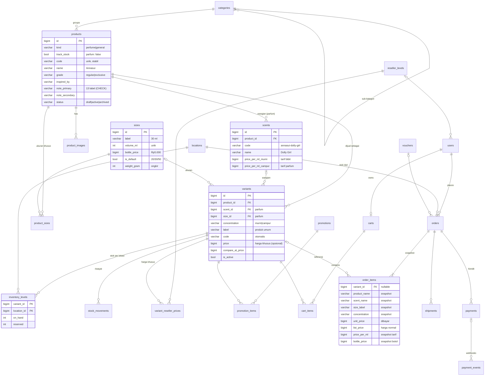

# Schema v3 — Station Parfume

| File | Isi |
|---|---|
| [`schema.sql`](schema.sql) | DDL lengkap PostgreSQL: 25 tabel, FK, CHECK, index, soft delete |
| [`../../src/repository/`](../../src/repository/) | Struct GORM: `user.go`, `catalog.go`, `commerce.go` (stok, reseller, promo, pengiriman, audit), `order.go` |
| [`../../src/catalog/`](../../src/catalog/) | Aturan bersama: varian bisa dibeli atau tidak, harga reseller, stok tersedia, `SetStock`, "buat kombinasi" |
| [`../../src/config/seeders/`](../../src/config/seeders/) + [`../../seed/`](../../seed/) | Seeder dari CSV (`go run ./seed`), lihat [`seed/README.md`](../../seed/README.md) |

**Update stok & foto (2026-11-10):** `products.track_stock` — parfum diracik sendiri → `false` (selalu tersedia, tidak di-reserve, tidak ada riwayat stok; bibit habis = nonaktifkan wangian/varian). Produk umum (barang jadi) → `true`. Bisa diubah admin per produk; `order_items.track_stock` menyimpan snapshot-nya. Foto: `product_images.url` = link CDN (file di-upload ke storage/CDN, bukan ke backend); endpoint admin tambah/ubah/hapus foto. Diuji: 40 cek HTTP lolos.

**Update harga (2026-11-10):** harga parfum dihitung, bukan diketik per varian: `tarif per ml wangian (murni = bibit / campur = parfum) × ml + harga botol ukuran`. Tarif ada di `scents`, harga botol di `sizes` (Rp5.000 semua ukuran), ukuran default 20/30/50 ml dan ukuran khusus per produk di `product_sizes`. `variants.price` sekarang = harga khusus opsional (mengalahkan rumus). Exclusive diganti 4 foto baru (11 wangian). Diuji: 28 cek HTTP lolos (harga rumus, ubah tarif, harga khusus, ukuran 10 ml khusus, reseller, snapshot order).

**Status (2026-11-09):** katalog lepas dari Shopee. Pembayaran lewat Xendit (tabel `payments`/`payment_events`; kode pembayaran masih Midtrans sampai M8). Diuji di Postgres 17 sementara: schema ter-apply bersih, seed idempoten (menjalankan ulang tidak menghapus harga/stok yang diisi admin), dan 43 cek HTTP lolos: katalog publik, admin (produk → wangian → kombinasi otomatis → harga massal → stok), hak akses per peran, harga reseller, checkout dengan reservasi stok, bayar, batal, dan kedaluwarsa.

---

## 1. Prinsip desain (untuk 5 tahun ke depan)

1. **Katalog milik sendiri.** Tidak ada kolom `shopee_*`. Struktur parfum diambil dari foto produk (bukan dari listing Shopee yang tidak konsisten).
2. **1 halaman = 1 grup foto.** Produk "Annasui" berisi wangian Sweet Dream & Dolly Girl. Pembeli memilih **Varian → Ukuran → Tipe (Murni/Campur)**.
3. **Harga dihitung dari tarif per ml, stok per kombinasi** (wangian × ukuran × tipe). Setiap kombinasi bisa dimatikan.
   ```
   harga = tarif per ml wangian (murni/"bibit" atau campur/"parfum") × volume + harga botol ukuran
   Victoria 30 ml murni  = 3.000 × 30 + 5.000 = Rp95.000
   Victoria 30 ml campur = 1.500 × 30 + 5.000 = Rp50.000
   ```
   `variants.price` = harga khusus opsional yang mengalahkan rumus (promo, ukuran spesial).
4. **Mudah untuk admin.** Tambah wangian + tarifnya → semua kombinasi ukuran × tipe dibuat otomatis dan langsung berharga. Tarif satu grup diubah sekaligus. Kode varian (SKU) dibuat otomatis, admin tidak pernah mengetiknya.
5. **Uang = `BIGINT` rupiah**, `int64` di Go. Total order divalidasi CHECK di database.
6. **Stok tidak pernah diubah diam-diam.** Setiap perubahan `on_hand` tercatat di `stock_movements` (siapa, kenapa, order mana). Perubahan harga/stok oleh staf juga masuk `audit_logs`.
7. **Siap tumbuh tanpa ubah struktur:** banyak lokasi/cabang (`locations`), level reseller, voucher, flash sale, ongkir otomatis (Biteship/RajaOngkir), banyak staf dengan peran tetap.

## 2. Tabel

```
1. reseller_levels · users (role: user|owner|admin|warehouse|cs, reseller_level_id) · user_addresses (+ area_id ongkir)
2. categories (parent_id) · products (kind perfume|general) · scents (+ tarif per ml) · product_images
   · sizes (+ harga botol, is_default) · product_sizes (ukuran khusus) · variants (price = harga khusus)
3. locations · inventory_levels (on_hand, reserved) · stock_movements
4. variant_reseller_prices
5. vouchers · promotions · promotion_items            (disiapkan, fitur nanti)
6. carts · cart_items (variant_id)
7. orders (location_id, voucher, reseller snapshot, expires_at) · order_items (snapshot) · voucher_redemptions
8. shipments (kurir, resi, provider)
9. payments · payment_events (Xendit)
10. audit_logs
```

### ERD katalog, stok, order



## 3. Keputusan penting

1. **`products.kind`.** Parfum wajib punya grade + 2 label aroma (CHECK); produk umum tidak boleh punya. Varian parfum wajib `scent + size + concentration`; varian umum ketiganya NULL dan boleh punya `label` (CHECK `variants_shape_chk`). FK komposit `(scent_id, product_id)` menjamin wangian milik produk yang sama.
2. **Regular dan Exclusive bernama sama = 2 parfum berbeda** (mis. Moonlight Escada vs Moonlight Exclusive). Karena itu kunci wangian adalah `code`, bukan nama.
3. **Harga parfum dihitung** (`catalog.ListPrice`): `variants.price` kalau diisi (harga khusus), kalau tidak `tarif wangian × volume + harga botol`. Tarif disimpan **per wangian** karena 1 foto bisa berisi tarif berbeda (Moonlight 4.000/2.000 vs Opus Black 5.000/3.000); admin bisa mengubah tarif 1 produk sekaligus. Wangian tanpa tarif tidak dijual. Produk umum memakai `variants.price` (wajib kalau aktif, CHECK).
4. **Ukuran = tabel.** `is_default` = dijual untuk semua parfum (20/30/50 ml). Parfum tertentu bisa punya daftar sendiri di `product_sizes` (mis. hanya 10/15/30 ml); daftar ini menggantikan ukuran default untuk produk itu. 1 ukuran = 1 jenis botol, jadi harga botol ada di `sizes`. **Tipe = Murni ("bibit") / Campur ("parfum")** tetap (CHECK).
5. **Stok hanya untuk produk `track_stock = true`** (produk umum). Parfum diracik sendiri → selalu tersedia (`available: null` di API). Untuk produk yang dihitung: **reserve → potong.** Checkout menambah `reserved` (stok tersedia = `on_hand − reserved`). Saat order `PAID`, `on_hand` dan `reserved` dikurangi dan dicatat `sale` di `stock_movements`. `CANCELLED`/`EXPIRED` sebelum bayar hanya melepas `reserved`. Order tidak dibayar dalam 24 jam otomatis `EXPIRED` (`ExpireOverdueOrders`, dijalankan tiap 5 menit dari `main.go`). Baris stok dikunci urut `variant_id` → checkout bersamaan tidak deadlock.
6. **Harga reseller:** `variant_reseller_prices` (harga khusus) → kalau tidak ada, `price × (100 − discount_percent) / 100`. Order menyimpan `unit_price` (yang dibayar) dan `list_price` (harga normal), plus nama level reseller.
7. **Snapshot di `order_items`.** Nama produk, wangian, ukuran, tipe, kode, harga, tarif per ml, dan harga botol disalin saat checkout, jadi perubahan tarif tidak mengubah order lama. FK ke varian/produk hanya referensi (`ON DELETE SET NULL`).
8. **Peran tetap.** `owner` (semua + kelola akun staf), `admin` (produk, harga, stok, pesanan), `warehouse` (stok, proses & kirim pesanan), `cs` (disiapkan untuk lihat pesanan). Login staf lewat `/auth/login/admin`.
9. **Soft delete + partial unique index** di tabel utama; tabel log (`stock_movements`, `audit_logs`, `payment_events`) append-only.
10. **Skala.** ±60 produk × 2 wangian × 3 ukuran × 2 tipe ≈ 750 varian, puluhan ribu order/tahun — kecil untuk PostgreSQL. Index sudah ada untuk listing publik, filter grade/label, riwayat stok, order per user/status, dan order yang akan kedaluwarsa.

### Catatan GORM

- **Jangan `AutoMigrate`.** Partial index, CHECK, dan FK komposit hanya ada di `schema.sql`.
- Field `bool` (`IsActive`) sengaja **tanpa** tag `default`, supaya `false` bisa disimpan.
- Kolom nullable memakai pointer (`*int64` untuk `price`, `*string`, `*time.Time`).

## 4. Status order

| `orders.status` | Arti | Stok |
|---|---|---|
| `PENDING_PAYMENT` | Belum bayar (batas `expires_at`) | di-reserve |
| `PAID` | Pembayaran Xendit terverifikasi | dipotong (`sale`) |
| `PROCESSING` | Dikemas | — |
| `SHIPPED` | Dikirim (resi di `shipments`) | — |
| `COMPLETED` | Selesai | — |
| `CANCELLED` | Dibatalkan | reservasi dilepas (kalau belum bayar) |
| `EXPIRED` | Tidak dibayar sampai batas waktu | reservasi dilepas |
| `REFUNDED` | Dana dikembalikan | tidak otomatis; barang kembali dicatat admin (`return`) |

## 5. API katalog

Publik (tanpa login): `GET /categories`, `GET /sizes`, `GET /products?category=&kind=&grade=&note=&q=`, `GET /products/:id-atau-slug`.

Admin (owner, admin): `GET|POST /admin/products`, `GET|PATCH /admin/products/:id`, `PATCH /admin/products/:id/rates` (tarif semua wangian), `PUT /admin/products/:id/sizes` (ukuran khusus), `POST /admin/products/:id/scents` (+ tarif, kombinasi otomatis), `POST /admin/products/:id/variants/generate`, `POST /admin/products/:id/variants` (produk umum), `PATCH /admin/scents/:id` (nama, tarif, aktif), `PATCH /admin/variants` (harga khusus/aktif, banyak sekaligus), `GET|POST /admin/sizes`, `PATCH /admin/sizes/:id`.

Foto (owner, admin): `POST /admin/products/:id/images` (`url` = link CDN, `scent_id` opsional, `sort_order` 0 = sampul), `PATCH /admin/images/:id`, `DELETE /admin/images/:id`. Upload file langsung ke storage/CDN (mis. Cloudflare R2 / Cloudinary); backend hanya menyimpan link.

Stok (owner, admin, warehouse): `POST /admin/inventory/adjustments` (`mode: set|add`), `GET /admin/inventory/movements?variant_id=`.

## 6. Belum dibangun (tabel sudah siap)

- Voucher & flash sale (`vouchers`, `promotions`), ongkir otomatis (`shipments.provider`, `area_id`), endpoint kelola level reseller, akses CS.
- Integrasi Xendit di kode (sekarang Midtrans), dibangun di M8.

## 7. Menerapkan ke database

- **DB baru / data dev boleh dibuang:** jadikan `schema.sql` migrasi goose pertama (`migrations/00001_init.sql`).
- **DB sudah ada isinya:** buat migrasi expand → backfill → contract setelah M2 (goose) selesai.
