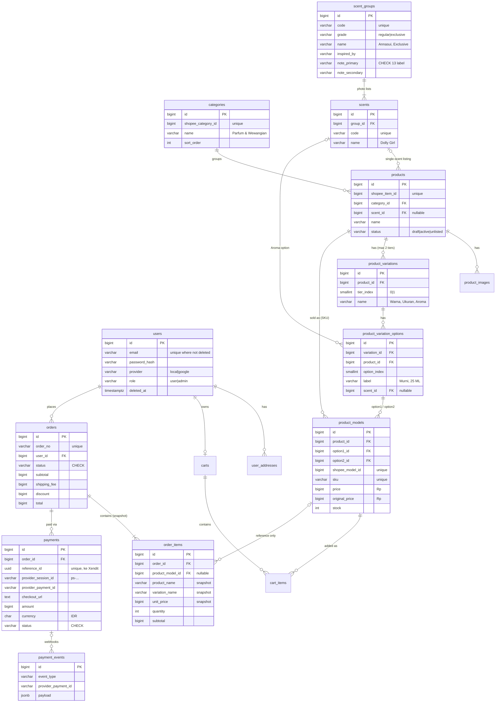

# Schema v2 — Station Parfume (Shopee-aligned)

| File | Isi |
|---|---|
| [`schema.sql`](schema.sql) | DDL lengkap PostgreSQL: 16 tabel, FK, CHECK, index, soft delete |
| [`../../src/repository/`](../../src/repository/) | Struct GORM (`user.go`, `catalog.go`, `order.go`) + konstanta status. Menggantikan `repository.go` lama. |
| [`../../src/config/seeders/`](../../src/config/seeders/) | Seeder katalog (CSV) + admin, dijalankan lewat `go run ./seed` |

**Status:** dipakai semua modul (auth, user, admin, products, cart, order, payment). `config.ConnectDatabase()` **tidak lagi** menjalankan `AutoMigrate`/`DropColumn`, jadi database harus dibuat dari `schema.sql` dulu. Database lama (tabel `parfumes`, `order_statuses`, dll.) tidak kompatibel. Lihat §7.

**Wangian dari foto produk (2026-11-08).** Tabel `scent_groups` (1 foto = 1 grup: Regular/Exclusive, inspired by, 2 label aroma) dan `scents` (1 varian per bullet di foto), diisi dari `seed/wangian.csv` (62 foto → 53 grup Regular + 9 grup Exclusive, 123 varian). Listing menunjuk ke wangian lewat `products.scent_id` (listing 1 wangian) atau `product_variation_options.scent_id` (pilihan di variasi "Aroma"). Endpoint `GET /scents?grade=&note=`. Diuji di Postgres 17: seed idempoten, wangian yang hilang dari CSV dinonaktifkan, 17 cek HTTP lolos.

**Katalog disamakan dengan toko Shopee (2026-11-08).** Tabel `brands`, `aromas`, `bottles`, dan `product_shop_categories` dihapus. Kategori sekarang 1 per produk (`products.category_id`), sama seperti Shopee. Diuji di Postgres 17 sementara: schema ter-apply bersih, seed kategori + katalog idempoten, dan 20 cek HTTP lolos (kategori/produk publik, filter kategori, keranjang → checkout, stok berkurang, stok 0 ditolak).

**Sudah diuji (2026-11-06)** di Postgres 17 sementara: `schema.sql` ter-apply bersih, lalu 36 skenario lewat struct GORM + 2 cek langsung via psql lolos semua (insert/preload, constraint menolak data salah, snapshot order, dedup webhook, soft delete). `go build` dan `go vet` hijau.

---

## 1. Tujuan: website = cermin Shopee

Customer harus melihat hal yang **sama persis** di website dan di Shopee: kategori, judul produk, nama variasi, urutan pilihan, harga, harga coret, stok, dan SKU. Karena itu struktur katalog meniru toko Shopee 1:1:

| Di Shopee | Tabel | Catatan |
|---|---|---|
| "Kategori" di halaman toko | `categories` | `shopee_category_id` = ID kategori toko. 1 produk = 1 kategori |
| Produk / listing | `products` | `shopee_item_id` = ID listing di Shopee |
| Foto produk | `product_images` | `sort_order = 0` = foto sampul |
| Variasi 1 & Variasi 2 (nama) | `product_variations` | `tier_index` 0/1, maks 2 tingkat seperti Shopee |
| Pilihan variasi | `product_variation_options` | `option_index` = urutan tampil |
| Kombinasi variasi (harga, stok, SKU) | `product_models` | `shopee_model_id` = ID model di Shopee |
| SKU Induk | `products.parent_sku` | |
| Status pesanan: Belum Bayar / Dikemas / Dikirim / Selesai / Dibatalkan / Pengembalian | `orders.status` | mapping di §4 |

### Yang terlihat di toko `shopee.co.id/stationparfume` (dicek 2026-11-08)

- **88 produk, 7 kategori.** Kategorinya dibuat otomatis oleh Shopee dari kategori produk, bukan etalase buatan sendiri. Urutannya: Parfum & Wewangian (75), Souvenir & Hadiah (3), Kecantikan Lainnya (3), Aksesoris Interior Mobil (2), Perlengkapan Rumah Lainnya (1), Alat Pemeliharaan Rumah (1), Pengharum Ruangan & Aromaterapi (1). Isinya ada di [`seed/categories.csv`](../../seed/categories.csv).
- **Parfum dijual sebagai satu produk**: botol dan isi jadi satu. Tidak ada pilihan "botol" yang terpisah dari parfum.
- **Nama parfum** ada di judul listing (mis. "Anggelina Jolie", "SELENA GOMESH") atau sebagai pilihan variasi (listing "[NEW!] STATION PARFUME …" punya variasi "Aroma").
- **Jenis parfum dan ukuran adalah pilihan variasi.** Contoh dari toko:

  | Listing | Variasi 1 | Variasi 2 |
  |---|---|---|
  | MASTER Inspired parfume by MAHERZEIN | Warna: Campur, Murni | Ukuran: 15 ML, 25 ML, 35 ML, 50 ML |
  | [NEW!] STATION PARFUME Eau De Parfume … | Ukuran: 20ml campur, 20ml murni, 50ml campur, 50ml murni | Aroma: senses doga blue, … |
  | Refil parfum sholat / wangi arab | Ukuran: 20 | |

- **Stok per kombinasi variasi** (mis. "Murni, 25 ML" punya stok sendiri). Itu `product_models.stock`.
- **Botol spray, kantong kain, souvenir = listing biasa** di kategorinya masing-masing.

Jadi schema **tidak** punya tabel botol atau brand. Yang dijual ada di `products` → `product_variations` → `product_variation_options` → `product_models`. Wangiannya ada di tabel terpisah (§1b) dan ditautkan lewat `scent_id`:

```
categories          Parfum & Wewangian (shopee_category_id 11043198)
products            MASTER Inspired parfume by MAHERZEIN
product_variations  tier 0 = "Warna"     tier 1 = "Ukuran"
options             0 Campur             0 15 ML
                    1 Murni              1 25 ML …
product_models      (Campur, 15 ML) → Rp155.000  stok 5
                    (Murni, 25 ML)  → Rp205.000  stok 3
```

> ⚠️ Nama, harga, dan stok di contoh ini dari kartu produk Shopee yang sempat terbaca. Data **lengkap** 88 listing harus diisi dari export Seller Center (§6), karena halaman toko dilindungi captcha.

### 1b. Wangian dari foto produk

Listing Shopee berantakan (wangian yang satu foto tersebar di beberapa listing, nama variasi tidak seragam), jadi **struktur wangian diambil dari foto produk**, bukan dari listing:

```
grade      scent_groups (1 foto)                 scents (bullet di foto)
regular    Annasui   · Inspired by Anna sui      Sweet Dream, Dolly Girl
           · SWEET + FRUITY
regular    1000 Bunga · FLORAL + WOODY           1000 Bunga  (tanpa varian = 1 baris)
exclusive  Exclusive  · AROMATIC + MUSK          Doga Blue, Grey Uomo, Intenso, Killer Queen, Lady Avanue
```

- **Regular dan Exclusive adalah 2 jenis parfum berbeda**, walaupun namanya sama (Moonlight, Bali, Scandalouse, Pink Chiffon). Karena itu kuncinya `code` (`escada-moonlight` ≠ `exclusive-4-moonlight`), bukan nama.
- **Label aroma** = 13 nilai tetap (CHECK di DB): amber, aromatic, balsamic, citrus, creamy, floral, fresh, fruity, musk, oud, powdery, sweet, woody. Di foto tertulis juga "MUSKY" dan "CYTRUS"; keduanya disatukan ke `musk` dan `citrus` supaya filter tidak terpecah.
- **Nama varian disalin persis seperti di foto** (Dunhil, Burberies, Screetwish, Avanue, …).
- **Tautan ke listing:** `products.scent_id` untuk listing 1 wangian (mis. "Anggelina Jolie" dengan variasi Warna × Ukuran), atau `product_variation_options.scent_id` untuk pilihan di variasi bernama "Aroma". Diisi lewat kolom `scent` di `catalog.csv`.
- Catatan data: "Blue Motion" dan "Lady Avanue" masing-masing muncul di 2 foto Exclusive, jadi tercatat 2 kali (kode berbeda). Gabungkan di `wangian.csv` kalau ternyata parfum yang sama.

---

## 2. ERD



---

## 3. Keputusan desain

1. **Parfum = 1 produk, tanpa master botol/brand; wangian dari foto produk.** Parfum dijual utuh (botol + isi); jenis (Campur/Murni) dan ukuran ml adalah pilihan variasi. Struktur wangian (Regular/Exclusive → grup → varian + 2 label aroma) disimpan di `scent_groups`/`scents` sesuai foto produk, karena listing Shopee tidak konsisten. Tabel `aromas`, `bottles`, `brands` lama tidak dipakai lagi.
2. **Kategori = kategori toko Shopee, 1 per produk.** Shopee membuat kategori toko otomatis dari kategori produk, jadi tiap listing tepat di 1 kategori. Karena itu cukup `products.category_id NOT NULL` (FK `RESTRICT`: kategori yang masih dipakai tidak bisa dihapus). Kolom `product_type` dihapus karena kategorilah yang membedakan parfum, botol, dan souvenir.
3. **Harga dan stok di `product_models`**, sama seperti Shopee (per kombinasi variasi). Harga diisi angka yang sama dengan di Shopee. Model lama (`price_ml` × ukuran + harga botol) sudah dihapus karena hasilnya bisa beda dengan Shopee.
4. **Uang = `BIGINT` rupiah, `int64` di Go.** Tidak ada `float`. Total order divalidasi DB: `total = subtotal + shipping_fee - discount`, dan `order_items.subtotal = unit_price × quantity`.
5. **Snapshot di `order_items`.** Nama produk, nama variasi, SKU, gambar, harga, dan harga coret disalin saat checkout. FK ke `product_models`/`products` hanya referensi (`ON DELETE SET NULL`). Sudah diuji: harga model diubah atau produk dihapus, order tetap sama.
6. **Status = `VARCHAR` + `CHECK`**, dengan konstanta Go di `src/repository/order.go` dan `CanOrderTransition()` (transisi hanya maju). Tabel lookup `order_statuses` beserta ID magic-nya dihapus.
7. **Integritas variasi dijaga DB, bukan cuma kode:**
   - `tier_index IN (0,1)`, jadi maksimal 2 tingkat seperti Shopee.
   - FK komposit `(option_id, product_id)`, sehingga model tidak bisa memakai pilihan milik produk lain.
   - Unique `(product_id, option1, option2)`, sehingga kombinasi tidak dobel (produk tanpa variasi juga hanya bisa punya 1 model).
8. **Soft delete + partial unique index.** Semua tabel utama punya `deleted_at`. Unique `email`, `slug`, `sku`, `shopee_item_id` hanya berlaku untuk baris aktif (`WHERE deleted_at IS NULL`), sehingga email atau slug yang sudah dihapus bisa dipakai lagi (memperbaiki D10 di audit). Yang sengaja **tanpa** soft delete: `order_items` (ikut order), `payment_events` (log append-only), tabel anak katalog yang ikut induknya (`product_images`, `product_variations`, `product_variation_options`), dan `cart_items`.
9. **Keranjang tanpa harga.** `carts` 1 per user, `cart_items` unik per model. Harga selalu dibaca live dari `product_models`, seperti di Shopee. Kolom `total_price` lama dihapus karena bisa basi.
10. **Xendit (Payment Sessions)** sesuai desain §9 audit:
   - `reference_id` UUID milik kita disimpan **sebelum** memanggil Xendit, sehingga aman di-retry.
   - `provider_session_id`, `provider_payment_id`, dan `checkout_url` disimpan dari respons.
   - Maksimal 1 payment `PENDING` dan 1 `PAID` per order (partial unique index).
   - `currency` dikunci `IDR`.
   - `payment_events` dengan unique `(provider, event_type, provider_payment_id)` membuat webhook duplikat jadi no-op.
   - Index `expires_at WHERE status='PENDING'` untuk job rekonsiliasi.
   - `provider` juga menerima `'midtrans'` untuk data lama.
11. **`TIMESTAMPTZ` di semua kolom waktu, ID `BIGINT IDENTITY`.** Di Go tetap `uint` agar cocok dengan kode JWT yang ada.

### Catatan GORM

- **Jangan `AutoMigrate`.** Partial index, CHECK, dan FK komposit hanya ada di `schema.sql`. Ini selaras dengan M2: startup tidak boleh mengubah schema.
- Field `bool` seperti `IsActive` sengaja **tanpa** tag `default`. GORM melewati nilai zero (`false`) kalau ada default, sehingga produk tidak bisa disimpan sebagai nonaktif. Isi `IsActive: true` secara eksplisit saat create.
- `ProductVariationOption.ProductID` wajib diisi sama dengan `product_id` variasinya. FK komposit akan menolak kalau salah.
- Kolom nullable memakai pointer (`*string`, `*int64`, `*time.Time`).

---

## 4. Mapping status ke tab Shopee

| `orders.status` | Tab di Shopee | Masuk karena |
|---|---|---|
| `PENDING_PAYMENT` | Belum Bayar | checkout dibuat |
| `PAID` | Dikemas | webhook Xendit terverifikasi |
| `PROCESSING` | Dikemas | admin mulai mengemas |
| `SHIPPED` | Dikirim | admin input resi (`tracking_number`) |
| `COMPLETED` | Selesai | customer konfirmasi / otomatis |
| `CANCELLED` | Dibatalkan | user/admin batal |
| `EXPIRED` | Dibatalkan | payment kedaluwarsa (rekonsiliasi) |
| `REFUNDED` | Pengembalian | refund manual via Dashboard Xendit |

Payment: `PENDING → PAID | EXPIRED | CANCELLED | FAILED`, dan `PAID → REFUNDED`.

---

## 5. Yang belum dicakup (sengaja)

- **Stok bahan (ml minyak, pcs botol kosong).** Stok hanya ada per kombinasi variasi, sama seperti Shopee. Kalau satu parfum dijual di beberapa ukuran, stok bahannya sebenarnya berbagi, tapi itu dicatat di luar sistem (seperti di Shopee).
- **Etalase buatan sendiri (many-to-many).** Toko ini hanya memakai kategori otomatis Shopee. Kalau nanti membuat etalase manual di Shopee, tambahkan tabel join `product_collections`.
- **Voucher/promo, ongkir otomatis, ulasan, sinkronisasi otomatis ke Shopee API.** Kolom `shopee_item_id` dan `shopee_model_id` sudah disiapkan untuk sinkronisasi nanti.

---

## 6. Mengisi data dari Shopee

Cara paling akurat agar website identik dengan Shopee: di **Seller Center → Produk Saya → Mass Update / Ubah Massal**, download file Excel produk. File itu berisi ID produk, ID variasi, nama variasi, SKU, harga, dan stok. Salin datanya ke `seed/catalog.csv`, lalu jalankan `go run ./seed` (lihat [`seed/README.md`](../../seed/README.md)). Seeder mengisi `products`, `product_variations`, `product_variation_options`, dan `product_models`, termasuk `shopee_item_id`/`shopee_model_id`. ⚠️ Nama kolom di file export Shopee berbeda dengan kolom `catalog.csv`, jadi perlu dipetakan saat menyalin.

## 7. Menerapkan ke database

- **DB baru / data dev boleh dibuang:** jadikan `schema.sql` migrasi goose pertama (`migrations/00001_init.sql`, tambahkan `-- +goose Up` / `-- +goose Down` berisi `DROP TABLE … CASCADE`).
- **DB sudah ada isinya:** buat migrasi expand → backfill → contract (tabel lama `parfumes`, `bottles`, `order_statuses` dipetakan ke tabel baru; parfum + botol lama menjadi pilihan variasi), dikerjakan di M6/M7 setelah M2 (goose) selesai. Jawab dulu Open Question #1 di audit (apakah ada data produksi).
