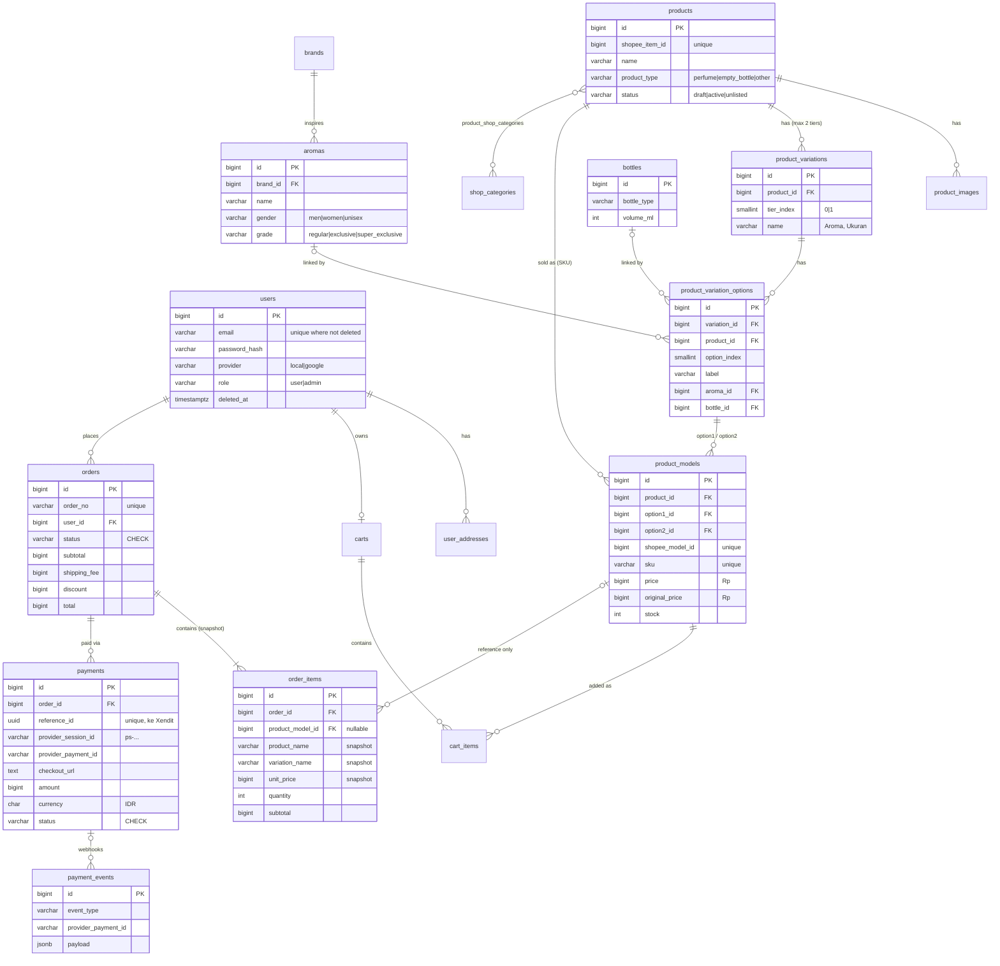

# Schema v2 — Station Parfume (Shopee-aligned)

| File | Isi |
|---|---|
| [`schema.sql`](schema.sql) | DDL lengkap PostgreSQL: 18 tabel, FK, CHECK, index, soft delete |
| [`../../src/repository/`](../../src/repository/) | Struct GORM (`user.go`, `catalog.go`, `order.go`) + konstanta status. Menggantikan `repository.go` lama. |
| [`../../src/config/seeders/`](../../src/config/seeders/) | Seeder katalog (CSV) + admin, dijalankan lewat `go run ./cmd/seed` |

**Status:** dipakai semua modul (auth, user, admin, products, cart, order, payment). `config.ConnectDatabase()` **tidak lagi** menjalankan `AutoMigrate`/`DropColumn`, jadi database harus dibuat dari `schema.sql` dulu. Database lama (tabel `parfumes`, `order_statuses`, dll.) tidak kompatibel. Lihat §7.

**Sudah diuji (2026-11-06)** di Postgres 17 sementara: `schema.sql` ter-apply bersih, lalu 36 skenario lewat struct GORM + 2 cek langsung via psql lolos semua (insert/preload, constraint menolak data salah, snapshot order, dedup webhook, soft delete). `go build` dan `go vet` hijau.

---

## 1. Tujuan: website = cermin Shopee

Customer harus melihat hal yang **sama persis** di website dan di Shopee: judul produk, nama variasi ("Aroma", "Ukuran"), urutan pilihan, harga, harga coret, dan SKU. Karena itu struktur katalog meniru model listing Shopee 1:1:

| Di Shopee Seller Center | Tabel | Catatan |
|---|---|---|
| Produk / listing | `products` | `shopee_item_id` = ID listing di Shopee |
| Etalase toko | `shop_categories` + `product_shop_categories` | many-to-many, sama seperti Shopee |
| Foto produk | `product_images` | `sort_order = 0` = foto sampul |
| Variasi 1 & Variasi 2 (nama) | `product_variations` | `tier_index` 0/1, maks 2 tingkat seperti Shopee |
| Pilihan variasi | `product_variation_options` | `option_index` = urutan tampil |
| Kombinasi variasi (harga, stok, SKU) | `product_models` | `shopee_model_id` = ID model di Shopee |
| SKU Induk | `products.parent_sku` | |
| Status pesanan: Belum Bayar / Dikemas / Dikirim / Selesai / Dibatalkan / Pengembalian | `orders.status` | mapping di §4 |

Contoh listing "Parfum Refill Exclusive":

```
products            Parfum Refill Exclusive
product_variations  tier 0 = "Aroma"            tier 1 = "Ukuran"
options             0 Baccarat Rouge            0 30ml Spray
                    1 Aventus                   1 50ml Spray
                    … (50+ aroma)
product_models      (Baccarat Rouge, 30ml Spray) → Rp45.000  SKU EXC-BR-30
                    (Baccarat Rouge, 50ml Spray) → Rp65.000  SKU EXC-BR-50
                    (Aventus, 30ml Spray)        → Rp85.000  …
```

Botol kosong = listing terpisah (`product_type = 'empty_bottle'`) dengan 1 tingkat variasi ("Model/Ukuran"), atau tanpa variasi (1 model dengan `option1_id = NULL`).

> ⚠️ **Data Shopee belum diambil.** Halaman toko `shopee.co.id/stationparfume` menolak akses otomatis (halaman verifikasi trafik), dan file `Produk_Station_Parfume.xlsx` yang dipakai seeder tidak ada di mesin ini. Jadi nama listing, daftar aroma, ukuran botol, dan harga di dokumen ini hanya **contoh**. Data asli sebaiknya diisi dari export Seller Center (§6).

---

## 2. ERD



---

## 3. Keputusan desain

1. **Listing ≠ aroma.** `aromas` dan `bottles` adalah master data internal (catatan aroma, brand inspirasi, volume botol). Yang dilihat dan dibeli customer adalah `products` → `product_models`, persis seperti Shopee. Pilihan variasi boleh menunjuk ke `aroma_id`/`bottle_id`, jadi filter "semua produk beraroma Aventus" tetap bisa.
2. **Harga di `product_models`, bukan di aroma atau botol.** Ini memenuhi "harga berbeda per kombinasi parfum + botol" tanpa rumus. Harga di website diisi angka yang sama dengan di Shopee. Model lama (`price_ml` × ukuran + harga botol) dihapus karena hasilnya bisa beda dengan Shopee.
3. **Uang = `BIGINT` rupiah, `int64` di Go.** Tidak ada `float`. Total order divalidasi DB: `total = subtotal + shipping_fee - discount`, dan `order_items.subtotal = unit_price × quantity`.
4. **Snapshot di `order_items`.** Nama produk, nama variasi, SKU, gambar, harga, dan harga coret disalin saat checkout. FK ke `product_models`/`products` hanya referensi (`ON DELETE SET NULL`). Sudah diuji: harga model diubah atau produk dihapus, order tetap sama.
5. **Status = `VARCHAR` + `CHECK`**, dengan konstanta Go di `src/repository/order.go` dan `CanOrderTransition()` (transisi hanya maju). Tabel lookup `order_statuses` beserta ID magic-nya dihapus.
6. **Integritas variasi dijaga DB, bukan cuma kode:**
   - `tier_index IN (0,1)`, jadi maksimal 2 tingkat seperti Shopee.
   - FK komposit `(option_id, product_id)`, sehingga model tidak bisa memakai pilihan milik produk lain.
   - Unique `(product_id, option1, option2)`, sehingga kombinasi tidak dobel (produk tanpa variasi juga hanya bisa punya 1 model).
7. **Soft delete + partial unique index.** Semua tabel utama punya `deleted_at`. Unique `email`, `slug`, `sku`, `shopee_item_id` hanya berlaku untuk baris aktif (`WHERE deleted_at IS NULL`), sehingga email atau slug yang sudah dihapus bisa dipakai lagi (memperbaiki D10 di audit). Yang sengaja **tanpa** soft delete: `order_items` (ikut order), `payment_events` (log append-only), tabel anak katalog yang ikut induknya (`product_images`, `product_variations`, `product_variation_options`), dan `cart_items`.
8. **Keranjang tanpa harga.** `carts` 1 per user, `cart_items` unik per model. Harga selalu dibaca live dari `product_models`, seperti di Shopee. Kolom `total_price` lama dihapus karena bisa basi.
9. **Xendit (Payment Sessions)** sesuai desain §9 audit:
   - `reference_id` UUID milik kita disimpan **sebelum** memanggil Xendit, sehingga aman di-retry.
   - `provider_session_id`, `provider_payment_id`, dan `checkout_url` disimpan dari respons.
   - Maksimal 1 payment `PENDING` dan 1 `PAID` per order (partial unique index).
   - `currency` dikunci `IDR`.
   - `payment_events` dengan unique `(provider, event_type, provider_payment_id)` membuat webhook duplikat jadi no-op.
   - Index `expires_at WHERE status='PENDING'` untuk job rekonsiliasi.
   - `provider` juga menerima `'midtrans'` untuk data lama.
10. **`TIMESTAMPTZ` di semua kolom waktu, ID `BIGINT IDENTITY`.** Di Go tetap `uint` agar cocok dengan kode JWT yang ada.

### Catatan GORM

- **Jangan `AutoMigrate`.** Partial index, CHECK, dan FK komposit hanya ada di `schema.sql`. Ini selaras dengan M2: startup tidak boleh mengubah schema.
- Field `bool` seperti `IsActive` sengaja **tanpa** tag `default`. GORM melewati nilai zero (`false`) kalau ada default, sehingga produk tidak bisa disimpan sebagai nonaktif. Isi `IsActive: true` secara eksplisit saat create.
- `ProductVariationOption.ProductID` wajib diisi sama dengan `product_id` variasinya. FK komposit akan menolak kalau salah.
- Kolom nullable memakai pointer (`*string`, `*int64`, `*time.Time`).

---

## 4. Mapping status ke tab Shopee

| `orders.status` | Tab di Shopee | Masuk karena |
|---|---|---|
| `PENDING_PAYMENT` | Belum Bayar | checkout dibuat |
| `PAID` | Dikemas | webhook Xendit terverifikasi |
| `PROCESSING` | Dikemas | admin mulai mengemas |
| `SHIPPED` | Dikirim | admin input resi (`tracking_number`) |
| `COMPLETED` | Selesai | customer konfirmasi / otomatis |
| `CANCELLED` | Dibatalkan | user/admin batal |
| `EXPIRED` | Dibatalkan | payment kedaluwarsa (rekonsiliasi) |
| `REFUNDED` | Pengembalian | refund manual via Dashboard Xendit |

Payment: `PENDING → PAID | EXPIRED | CANCELLED | FAILED`, dan `PAID → REFUNDED`.

---

## 5. Yang belum dicakup (sengaja)

- **Stok per aroma (ml minyak) dan per botol (pcs).** Saat ini stok ada di `product_models`, sama seperti Shopee. Kalau satu aroma dipakai di beberapa ukuran, stok riilnya sebenarnya berbagi. Kalau nanti perlu, tambahkan `aromas.stock_ml` dan `bottles.stock_qty`, lalu stok model dihitung.
- **Voucher/promo, ongkir otomatis, ulasan, sinkronisasi otomatis ke Shopee API.** Kolom `shopee_item_id` dan `shopee_model_id` sudah disiapkan untuk sinkronisasi nanti.

---

## 6. Mengisi data dari Shopee

Cara paling akurat agar website identik dengan Shopee: di **Seller Center → Produk Saya → Mass Update / Ubah Massal**, download file Excel produk. File itu berisi ID produk, ID variasi, nama variasi, SKU, harga, dan stok. Salin datanya ke `seed/catalog.csv`, lalu jalankan `go run ./cmd/seed` (lihat [`seed/README.md`](../../seed/README.md)). Seeder mengisi `products`, `product_variations`, `product_variation_options`, dan `product_models`, termasuk `shopee_item_id`/`shopee_model_id`. ⚠️ Nama kolom di file export Shopee berbeda dengan kolom `catalog.csv`, jadi perlu dipetakan saat menyalin.

## 7. Menerapkan ke database

- **DB baru / data dev boleh dibuang:** jadikan `schema.sql` migrasi goose pertama (`migrations/00001_init.sql`, tambahkan `-- +goose Up` / `-- +goose Down` berisi `DROP TABLE … CASCADE`).
- **DB sudah ada isinya:** buat migrasi expand → backfill → contract (tabel lama `parfumes`, `bottles`, `order_statuses` dipetakan ke tabel baru), dikerjakan di M6/M7 setelah M2 (goose) selesai. Jawab dulu Open Question #1 di audit (apakah ada data produksi).
